# Greater Bay Area

Thirteen analysis units represent the Pearl River Estuary and Hong Kong coastal sectors. Coastal water level is analyzed in CN1985; model entry uses the source-system-specific conversion documented in the methods.

| Analysis units | Observation interval | Vertical reference |
|--:|:--|:--|
| 13 | Daily | CN1985 |

[Study area and coverage](#study-area) · [Units](#analysis-units) · [Stations](#station-catalogue) · [Run](#run)

## Study area

[PDF figure atlas](figures/atlas.pdf) · Click a figure to open its editable SVG.

<p align="left">
  <a href="figures/00_regional_overview.svg">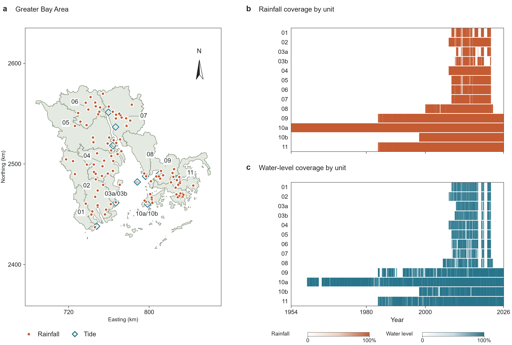</a>
</p>

Coverage refers to the archived compound-input record. Colour intensity represents the observed fraction of a calendar month; white indicates missing observations. Rainfall rows show actual source use. Annual-frequency analysis uses independently screened full records.

Panels b and c show rainfall and water-level coverage, respectively. Combined map labels identify polygons shared by two analysis units. Map coordinates use EPSG:32649, shown in kilometres.

## Analysis units

| Unit | Geographic polygon | Tide record |
|:--|:--|:--|
| 01 | 1 | Sanzao |
| 02 | 2 | Sanzao |
| 03a | 3 | Dajiu Zhou |
| 03b | 3 | Nei Lingding |
| 04 | 4 | Nansha |
| 05 | 5 | Nansha |
| 06 | 6 | Dasheng |
| 07 | 7 | Sishengwei |
| 08 | 8 | Chiwan |
| 09 | 9 | Tsim Bei Tsui |
| 10a | 10 | Quarry Bay |
| 10b | 10 | Shek Pik |
| 11 | 11 | Tai Po Kau |

<details markdown="1">
<summary>Partitioning principles</summary>

The geographic partition contains 11 coastal drainage polygons, grouped by major river outlets and receiving waters. Drainage paths follow the DEM and river network; small coastal drainage areas are joined to adjoining outlet groups. Tide assignments account for the receiving water body, usable records and a documented vertical reference.

The statistical analysis has 13 units because polygons 3 and 10 each have two rainfall–tide assignments. Units 03a and 03b share polygon 3 and use DJZ and NLT, respectively; 10a and 10b share polygon 10 and use QUB and SPW. These paired units retain the same geographic extent while using their separately assigned observation records.

See [Methods](../shared/methods.md#analysis-units) for the common partitioning principles.

</details>

<details markdown="1">
<summary>Station assignment diagram</summary>

[View the station assignment diagram](figures/02_station_assignments.svg).

</details>

## Station catalogue

[01](#unit-01) · [02](#unit-02) · [03a](#unit-03a) · [03b](#unit-03b) · [04](#unit-04) · [05](#unit-05) · [06](#unit-06) · [07](#unit-07) · [08](#unit-08) · [09](#unit-09) · [10a](#unit-10a) · [10b](#unit-10b) · [11](#unit-11)

First and last use refer to actual station contributions. Panel a maps the stations; panel b shows monthly rainfall-source contributions; panel c compares water-level coverage (solid line) with paired coverage (dashed line). Map numbers follow the rainfall table rows. White in panel b indicates no contribution.

<details markdown="1">
<summary><strong>Unit 01</strong> · Sanzao · 1 rainfall station</summary>

### Unit 01

Tide station: Sanzao · ID: `SZ`.

| Priority | Rainfall station | ID | First use | Last use |
|--:|:--|:--|:--|:--|
| 1 | G1205 | `G1205` | 2008-11-20 | 2022-04-30 |

<p align="left">
  <a href="figures/01_overview.svg">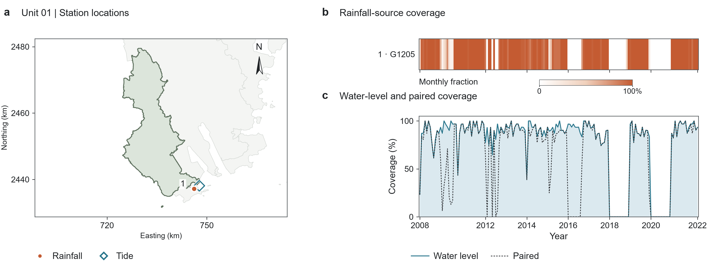</a>
</p>

</details>

<details markdown="1">
<summary><strong>Unit 02</strong> · Sanzao · 15 rainfall stations</summary>

### Unit 02

Tide station: Sanzao · ID: `SZ`.

| Priority | Rainfall station | ID | First use | Last use |
|--:|:--|:--|:--|:--|
| 1 | G1210 | `G1210` | 2009-04-01 | 2022-04-30 |
| 2 | G1217 | `G1217` | 2011-04-02 | 2021-12-31 |
| 3 | G1256 | `G1256` | 2019-12-09 | 2021-03-08 |
| 4 | G1230 | `G1230` | 2017-08-24 | 2020-12-28 |
| 5 | G1206 | `G1206` | 2008-11-20 | 2016-05-20 |
| 6 | G2037 | `G2037` | 2012-11-29 | 2018-02-06 |
| 7 | 59487 | `59487` | 2008-01-01 | 2014-12-25 |
| 8 | G1212 | `G1212` | 2010-02-05 | 2015-03-10 |
| 10 | G2036 | `G2036` | 2015-06-18 | 2017-03-14 |
| 12 | G2010 | `G2010` | 2010-04-13 | 2017-08-23 |
| 14 | G2038 | `G2038` | 2010-02-10 | 2010-02-10 |
| 17 | G2004 | `G2004` | 2010-05-05 | 2016-03-10 |
| 23 | G2102 | `G2102` | 2010-05-04 | 2010-05-04 |
| 27 | G2021 | `G2021` | 2010-06-19 | 2010-06-19 |
| 31 | G2128 | `G2128` | 2010-06-13 | 2010-06-29 |

<p align="left">
  <a href="figures/02_overview.svg">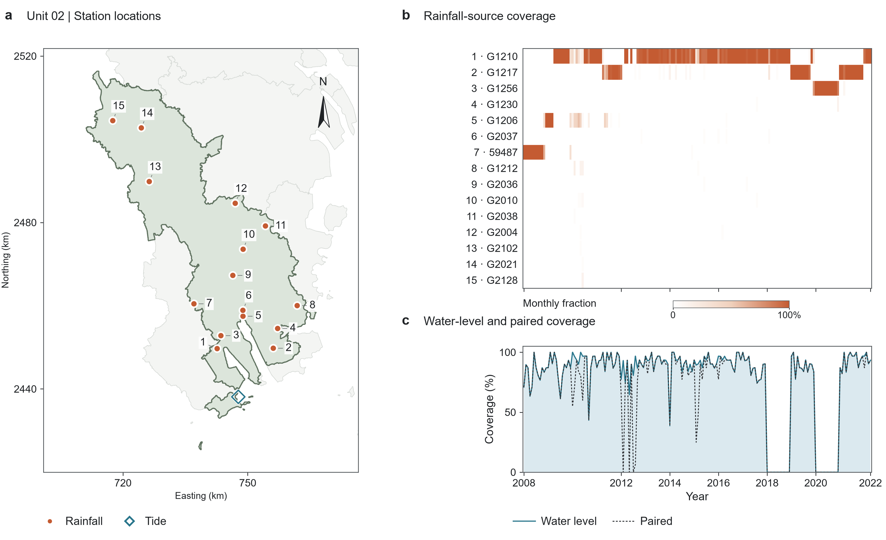</a>
</p>

</details>

<details markdown="1">
<summary><strong>Unit 03a</strong> · Dajiu Zhou · 1 rainfall station</summary>

### Unit 03a

Tide station: Dajiu Zhou · ID: `DJZ`.

| Priority | Rainfall station | ID | First use | Last use |
|--:|:--|:--|:--|:--|
| 1 | G1209 | `G1209` | 2010-06-01 | 2022-04-30 |

<p align="left">
  <a href="figures/03a_overview.svg">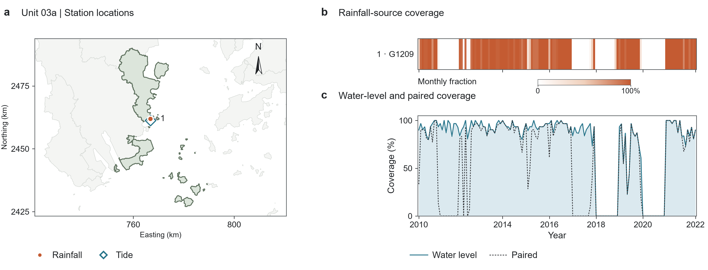</a>
</p>

</details>

<details markdown="1">
<summary><strong>Unit 03b</strong> · Nei Lingding · 1 rainfall station</summary>

### Unit 03b

Tide station: Nei Lingding · ID: `NLT`.

| Priority | Rainfall station | ID | First use | Last use |
|--:|:--|:--|:--|:--|
| 1 | G1211 | `G1211` | 2010-01-01 | 2022-04-30 |

<p align="left">
  <a href="figures/03b_overview.svg">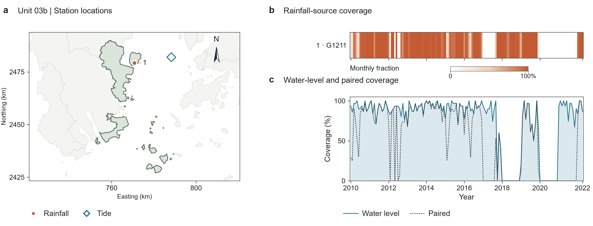</a>
</p>

</details>

<details markdown="1">
<summary><strong>Unit 04</strong> · Nansha · 13 rainfall stations</summary>

### Unit 04

Tide station: Nansha · ID: `NS`.

| Priority | Rainfall station | ID | First use | Last use |
|--:|:--|:--|:--|:--|
| 1 | G3202 | `G3202` | 2009-04-01 | 2022-04-30 |
| 2 | G3205 | `G3205` | 2008-11-20 | 2018-12-10 |
| 4 | G2045 | `G2045` | 2009-12-03 | 2010-06-26 |
| 5 | G2006 | `G2006` | 2009-01-01 | 2010-03-29 |
| 6 | G2022 | `G2022` | 2009-11-24 | 2009-12-25 |
| 8 | G2008 | `G2008` | 2010-01-29 | 2010-01-29 |
| 10 | G2052 | `G2052` | 2013-10-19 | 2013-10-19 |
| 13 | G2017 | `G2017` | 2010-01-25 | 2015-03-10 |
| 14 | G2005 | `G2005` | 2010-02-12 | 2016-03-10 |
| 16 | G2011 | `G2011` | 2010-06-09 | 2010-06-09 |
| 17 | G2026 | `G2026` | 2010-02-08 | 2010-02-08 |
| 18 | G2009 | `G2009` | 2010-01-26 | 2010-01-26 |
| 19 | 59485 | `59485` | 2008-01-01 | 2016-04-01 |

<p align="left">
  <a href="figures/04_overview.svg">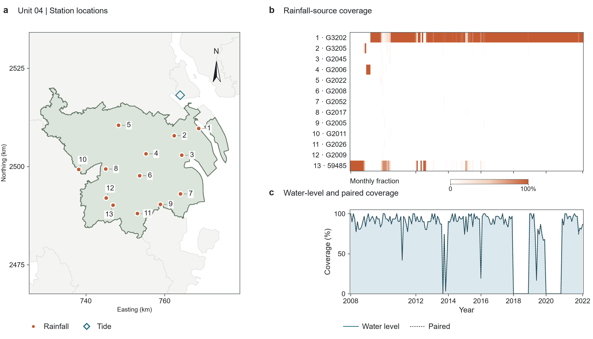</a>
</p>

</details>

<details markdown="1">
<summary><strong>Unit 05</strong> · Nansha · 7 rainfall stations</summary>

### Unit 05

Tide station: Nansha · ID: `NS`.

| Priority | Rainfall station | ID | First use | Last use |
|--:|:--|:--|:--|:--|
| 1 | G3239 | `G3239` | 2009-04-01 | 2022-04-30 |
| 2 | G3204 | `G3204` | 2008-11-20 | 2020-12-31 |
| 3 | G3213 | `G3213` | 2009-01-01 | 2018-06-07 |
| 4 | G3212 | `G3212` | 2015-03-10 | 2019-01-27 |
| 11 | G3111 | `G3111` | 2009-12-05 | 2013-10-19 |
| 12 | G3137 | `G3137` | 2009-11-24 | 2010-04-03 |
| 25 | G2238 | `G2238` | 2016-03-10 | 2016-03-10 |

<p align="left">
  <a href="figures/05_overview.svg">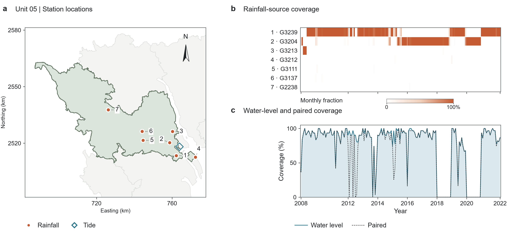</a>
</p>

</details>

<details markdown="1">
<summary><strong>Unit 06</strong> · Dasheng · 11 rainfall stations</summary>

### Unit 06

Tide station: Dasheng · ID: `DS`.

| Priority | Rainfall station | ID | First use | Last use |
|--:|:--|:--|:--|:--|
| 1 | G3136 | `G3136` | 2008-11-20 | 2022-04-30 |
| 2 | G1032 | `G1032` | 2008-12-31 | 2011-04-13 |
| 3 | G1018 | `G1018` | 2009-12-07 | 2015-07-09 |
| 6 | G3448 | `G3448` | 2009-11-08 | 2010-06-30 |
| 9 | G3238 | `G3238` | 2015-03-10 | 2015-03-10 |
| 12 | G1039 | `G1039` | 2009-12-08 | 2010-05-23 |
| 15 | G1099 | `G1099` | 2009-12-16 | 2009-12-30 |
| 19 | G1001 | `G1001` | 2010-02-06 | 2010-02-06 |
| 21 | G1087 | `G1087` | 2015-02-09 | 2015-07-05 |
| 28 | G3156 | `G3156` | 2016-03-10 | 2016-03-10 |
| 29 | G6816 | `G6816` | 2009-12-28 | 2009-12-28 |

<p align="left">
  <a href="figures/06_overview.svg">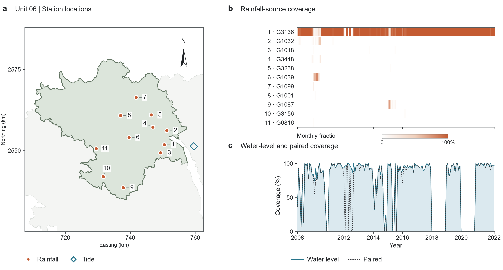</a>
</p>

</details>

<details markdown="1">
<summary><strong>Unit 07</strong> · Sishengwei · 16 rainfall stations</summary>

### Unit 07

Tide station: Sishengwei · ID: `SSW`.

| Priority | Rainfall station | ID | First use | Last use |
|--:|:--|:--|:--|:--|
| 1 | G1947 | `G1947` | 2008-11-20 | 2022-04-30 |
| 2 | G1935 | `G1935` | 2015-01-28 | 2021-03-16 |
| 3 | G1964 | `G1964` | 2009-11-12 | 2020-12-31 |
| 4 | G1915 | `G1915` | 2010-06-14 | 2010-09-07 |
| 5 | G1929 | `G1929` | 2010-01-22 | 2016-06-28 |
| 6 | G1956 | `G1956` | 2010-05-01 | 2016-06-05 |
| 7 | G1989 | `G1989` | 2009-12-09 | 2009-12-09 |
| 8 | G3201 | `G3201` | 2009-12-11 | 2010-06-27 |
| 9 | G1971 | `G1971` | 2015-03-10 | 2015-03-10 |
| 10 | G1945 | `G1945` | 2010-02-10 | 2010-02-26 |
| 12 | G1907 | `G1907` | 2010-01-17 | 2010-05-29 |
| 13 | 59289 | `59289` | 2010-01-01 | 2013-11-17 |
| 14 | G1072 | `G1072` | 2009-12-10 | 2009-12-30 |
| 23 | G3329 | `G3329` | 2009-11-18 | 2009-11-18 |
| 31 | G1961 | `G1961` | 2009-12-18 | 2009-12-18 |
| 40 | 59287 | `59287` | 2014-04-01 | 2014-12-25 |

<p align="left">
  <a href="figures/07_overview.svg">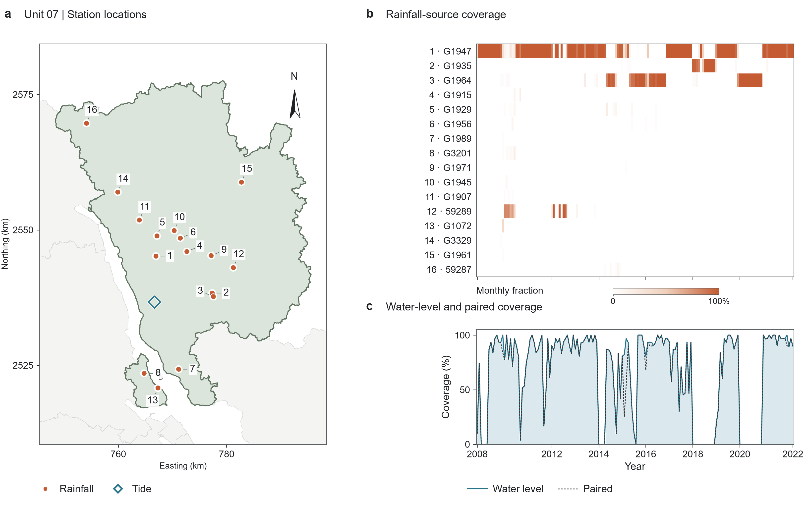</a>
</p>

</details>

<details markdown="1">
<summary><strong>Unit 08</strong> · Chiwan · 3 rainfall stations</summary>

### Unit 08

Tide station: Chiwan · ID: `CW`.

| Priority | Rainfall station | ID | First use | Last use |
|--:|:--|:--|:--|:--|
| 1 | G3521 | `G3521` | 2008-11-20 | 2022-04-30 |
| 3 | G3556 | `G3556` | 2009-02-16 | 2010-06-30 |
| 7 | GEO_N28 | `GEO_N28` | 2000-01-28 | 2022-12-30 |

<p align="left">
  <a href="figures/08_overview.svg">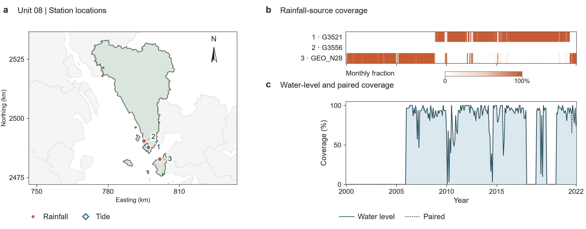</a>
</p>

</details>

<details markdown="1">
<summary><strong>Unit 09</strong> · Tsim Bei Tsui · 8 rainfall stations</summary>

### Unit 09

Tide station: Tsim Bei Tsui · ID: `TBT`.

| Priority | Rainfall station | ID | First use | Last use |
|--:|:--|:--|:--|:--|
| 1 | HKO_WLP | `HKO_WLP` | 2005-12-01 | 2026-07-31 |
| 2 | G3645 | `G3645` | 2017-05-23 | 2019-08-15 |
| 3 | HKO_LFS | `HKO_LFS` | 1985-10-01 | 2023-07-19 |
| 4 | GHCNH_CHM00045035 | `GHCNH_CHM00045035` | 2004-06-06 | 2014-07-07 |
| 5 | GEO_N33 | `GEO_N33` | 2000-01-21 | 2005-07-22 |
| 7 | GEO_N12 | `GEO_N12` | 1984-01-01 | 1999-05-31 |
| 49 | GEO_N05 | `GEO_N05` | 1989-01-12 | 1996-05-01 |
| 59 | HKO_TKL | `HKO_TKL` | 1988-07-27 | 1988-11-26 |

<p align="left">
  <a href="figures/09_overview.svg">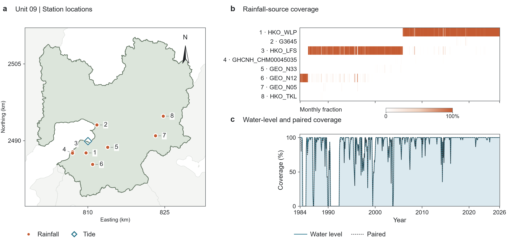</a>
</p>

</details>

<details markdown="1">
<summary><strong>Unit 10a</strong> · Quarry Bay · 9 rainfall stations</summary>

### Unit 10a

Tide station: Quarry Bay · ID: `QUB`.

| Priority | Rainfall station | ID | First use | Last use |
|--:|:--|:--|:--|:--|
| 1 | GEO_H18 | `GEO_H18` | 1984-01-01 | 2026-06-30 |
| 2 | GEO_H09 | `GEO_H09` | 1987-07-03 | 2018-01-03 |
| 3 | HKO_SE | `HKO_SE` | 2011-12-25 | 2026-07-31 |
| 4 | GEO_H19 | `GEO_H19` | 1984-04-21 | 1996-06-18 |
| 5 | HKO_SKW | `HKO_SKW` | 2008-02-29 | 2008-02-29 |
| 6 | GEO_K08 | `GEO_K08` | 1986-12-04 | 2000-09-27 |
| 7 | GEO_K05 | `GEO_K05` | 1988-05-19 | 1989-01-11 |
| 8 | GEO_H07 | `GEO_H07` | 1988-02-13 | 1988-09-25 |
| 13 | HKO_HKO | `HKO_HKO` | 1954-08-29 | 2004-12-13 |

<p align="left">
  <a href="figures/10a_overview.svg">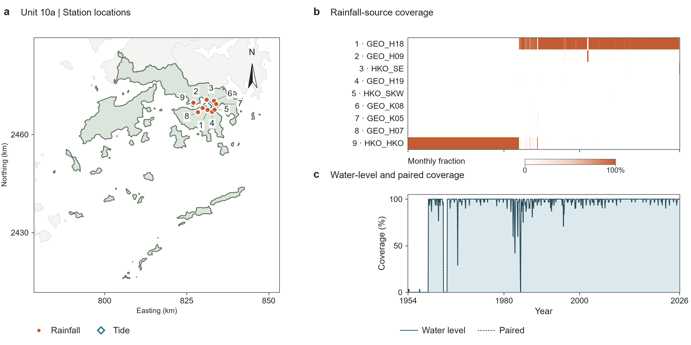</a>
</p>

</details>

<details markdown="1">
<summary><strong>Unit 10b</strong> · Shek Pik · 6 rainfall stations</summary>

### Unit 10b

Tide station: Shek Pik · ID: `SPW`.

| Priority | Rainfall station | ID | First use | Last use |
|--:|:--|:--|:--|:--|
| 1 | GEO_N19 | `GEO_N19` | 1999-11-01 | 2026-06-30 |
| 2 | GEO_N53 | `GEO_N53` | 2012-03-12 | 2026-06-12 |
| 3 | GEO_N22 | `GEO_N22` | 1999-11-19 | 2015-01-14 |
| 4 | GEO_N21 | `GEO_N21` | 2001-09-01 | 2005-04-30 |
| 5 | GEO_N17 | `GEO_N17` | 1998-01-01 | 2005-10-18 |
| 7 | HKO_HKA | `HKO_HKA` | 1998-01-26 | 2026-07-31 |

<p align="left">
  <a href="figures/10b_overview.svg">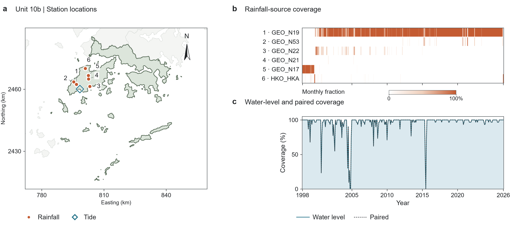</a>
</p>

</details>

<details markdown="1">
<summary><strong>Unit 11</strong> · Tai Po Kau · 10 rainfall stations</summary>

### Unit 11

Tide station: Tai Po Kau · ID: `TPK`.

| Priority | Rainfall station | ID | First use | Last use |
|--:|:--|:--|:--|:--|
| 1 | GEO_N41 | `GEO_N41` | 1999-11-01 | 2026-06-30 |
| 2 | GEO_N45 | `GEO_N45` | 2000-10-17 | 2025-06-24 |
| 3 | GEO_N35 | `GEO_N35` | 2005-10-18 | 2006-10-26 |
| 4 | GEO_N09 | `GEO_N09` | 1984-01-01 | 2000-01-16 |
| 5 | GHCNH_CHM00045039 | `GHCNH_CHM00045039` | 2004-12-11 | 2026-07-31 |
| 6 | HKO_SHA | `HKO_SHA` | 1985-03-26 | 2026-07-30 |
| 8 | GEO_N02 | `GEO_N02` | 1984-09-01 | 1996-06-18 |
| 10 | GEO_N14 | `GEO_N14` | 1984-04-05 | 1984-04-05 |
| 15 | GEO_N01 | `GEO_N01` | 1988-09-25 | 1988-09-25 |
| 30 | GEO_N13 | `GEO_N13` | 1984-05-16 | 1984-05-16 |

<p align="left">
  <a href="figures/11_overview.svg">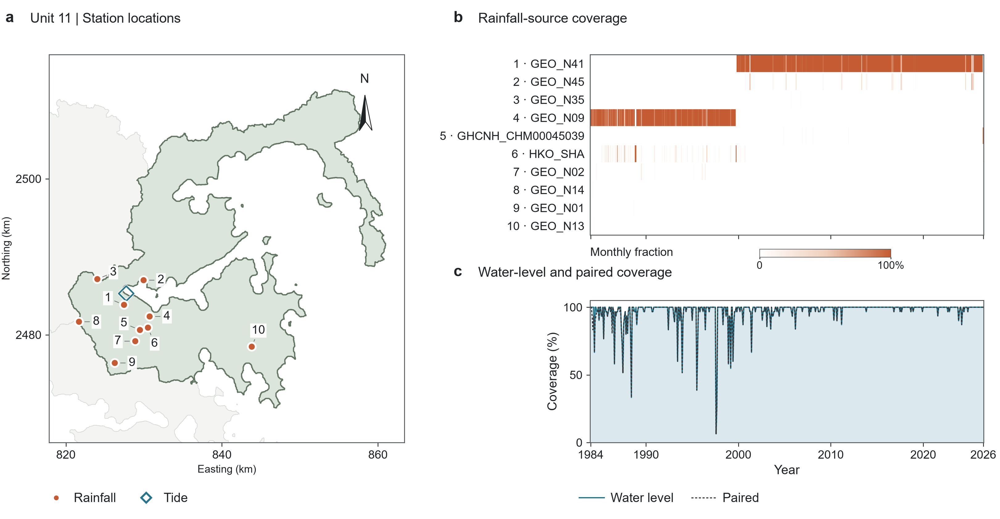</a>
</p>

</details>

## Regional settings

- Priority-merged daily rainfall is paired with the daily maximum coastal water level. The positive-day R95 threshold and three-day declustering define the event sample.
- Mainland S1 units 01-08, including 03a/03b, use index-rainfall regional frequency analysis with long-record stations within 60 km. L-moment ratios are record-length weighted; H1 screening removes farthest stations if needed.
- Daily rainfall designs and compound rainfall coordinates use the empirical factor 1.13 to express estimated moving-24-hour quantities.
- S2 uses full station records with annual/seasonal completeness and regional storm-day checks. Independently sourced supplemental peaks remain private observation inputs.
- DJZ transfers the SZ curve; NLT transfers the CW curve, adding the median concurrent annual-maximum difference.
- Units 01, 02, and 05 exclude the documented invalid storm-day event pairs. Unit 10a uses a nondegenerate water-level margin and Gaussian dependence.
- Rainfall and tide peaks occur at hour 12 in regular event-design cases.

## Run

From the repository root, install the package and run:

```sh
python -m pip install -e "."
python GBA/run_analysis.py --manifest ../private/gba/manifest.json --output ../outputs/gba
```

[run_analysis.py](run_analysis.py) executes steps 01–05: preparation, event selection, annual fitting, copula fitting and design export. [settings.py](settings.py) contains the regional parameters and station rules; [stations.json](stations.json) contains the station catalog. Use `--annual-only` for S1 and S2.

Read [Methods](../shared/methods.md) for the equations and [Inputs and sources](../shared/inputs.md) for observation formats. The study-area figures below are already in `figures/`.

Build the local documentation with `python build_docs.py --region gba` after installing `.[docs]`, then open `GBA/site/index.html`.
