# San Francisco Bay

Eleven units represent the bay's coastal catchment groups. All water levels enter inference in NAVD88. The analysis clock is fixed Pacific Standard Time (UTC-8), with October-to-September water years.

## Run

From the repository root, install the package and run:

```sh
python -m pip install -e "."
python SanF/run_analysis.py --manifest ../private/san_francisco/manifest.json --output ../outputs/san_francisco
```

[run_analysis.py](run_analysis.py) executes steps 01–05: preparation, event selection, annual fitting, copula fitting and design export. [settings.py](settings.py) contains the regional parameters and station rules; [stations.json](stations.json) contains the station catalog. Use `--annual-only` for S1 and S2.

Read [Methods](../shared/methods.md) for the equations and [Inputs and sources](../shared/inputs.md) for observation formats. The study-area figures below are already in `figures/`.

Build the local documentation with `python build_docs.py --region san_francisco` after installing `.[docs]`, then open `SanF/site/index.html`.

## Analysis units

The 31 source subcatchments, SB01–SB31, follow drainage outlets to the bay or adjacent coastal waters. Watershed divides are constrained by the DEM, river network and HUC12 boundaries. The final partition groups these subcatchments into 11 coastal-drainage units, as listed below.

During source-subcatchment delineation, drainage areas below 2 km² are joined to the neighbour with the longest shared boundary. Areas below 50 km² are preferentially joined to neighbouring small catchments below 120 km². The final 11 analysis groups retain the component IDs in the table.

Each group has a specified rainfall-source sequence and a coastal water-level record. A tide record can serve several groups: M04, M05, M08 and M10 use Redwood City, for example, but retain separate rainfall records and compound-event models. Group membership therefore carries information beyond the tide-station assignment.

See [Methods](../shared/methods.md#analysis-units) for the common partitioning principles.

| Unit | Component subcatchments | Tide record |
|:--|:--|:--|
| M01 | SB07, SB08, SB09, SB10 | Mare Island / Martinez |
| M02 | SB03, SB04, SB05, SB06 | Richmond |
| M03 | SB01, SB02, SB31 | San Francisco |
| M04 | SB30, SB29 | Redwood City |
| M05 | SB28, SB27 | Redwood City |
| M06 | SB26, SB25, SB24, SB23 | Alviso |
| M07 | SB22, SB21, SB20 | Alviso |
| M08 | SB18, SB19 | Redwood City |
| M09 | SB13, SB14, SB15 | Alameda |
| M10 | SB16, SB17 | Redwood City |
| M11 | SB12, SB11 | Richmond |

## Regional settings

- Hourly rainfall follows the declared source priority. Intact six-hour reports can fill wholly missing nonoverlapping blocks; they are not disaggregated.
- Twelve-hour event separation, same-window rainfall/water pairing, rainfall R95, and 72-hour water-peak declustering define the compound population.
- S1 uses complete moving-24-hour rainfall maxima from the full available source record. Reviewed isolated spikes are excluded for the declared stations.
- S2 uses each tide station's complete record with documented quality exclusions and explicit partial-year selection.
- Alviso's annual frequency curve transfers from Redwood City using accepted concurrent annual maxima from 2019 onward. The historical Alviso tie is an engineering reference.
- Regular rainfall and coastal peak times occur at hour 13. Phase cases apply the same relative offsets as the other regions.


## Study area and station assignments

Select a figure to inspect it at full resolution.

[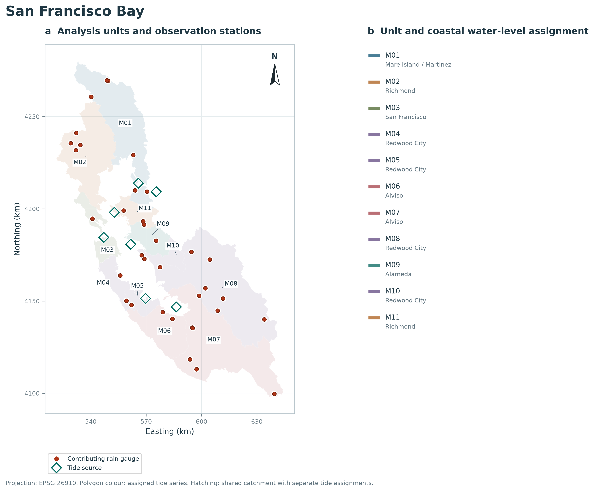](figures/01_study_area.png)

[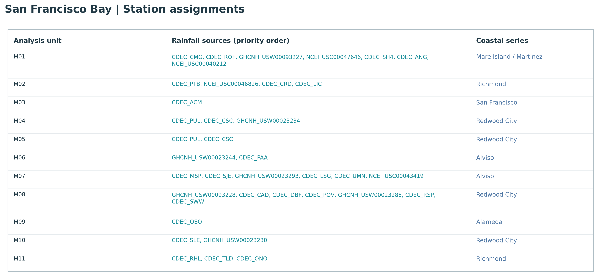](figures/02_station_assignments.png)

[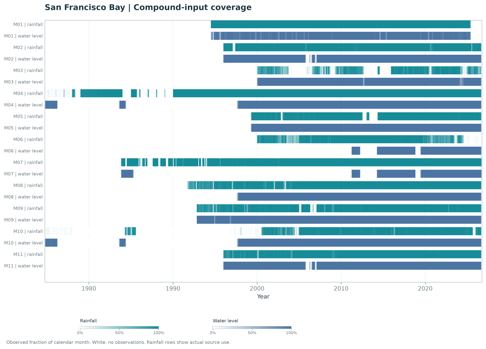](figures/03_observation_coverage.png)

Coverage refers to the archived compound-input record. Colour intensity represents the observed fraction of a calendar month; white indicates missing observations. Rainfall rows show actual source use. Annual-frequency analysis uses independently screened full records.

## Unit M01

Coastal series: Mare Island / Martinez. Sources: `NOAA_9415218`, `GESLA_CDWR_MRZ`.

[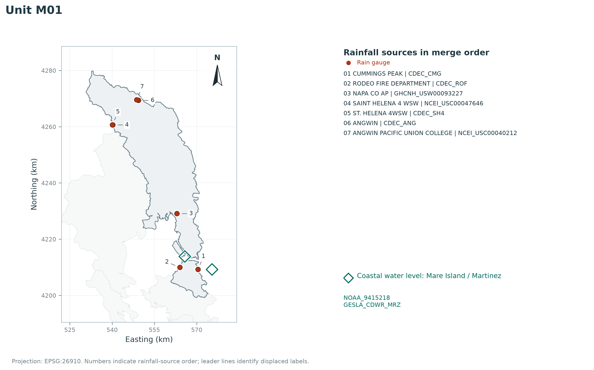](figures/M01_stations.png)

| Priority | Rainfall station | ID | First use | Last use |
|--:|:--|:--|:--|:--|
| 1 | CUMMINGS PEAK | `CDEC_CMG` | 2004-04-08 | 2025-05-24 |
| 2 | RODEO FIRE DEPARTMENT | `CDEC_ROF` | 2005-12-23 | 2024-07-01 |
| 3 | NAPA CO AP | `GHCNH_USW00093227` | 2001-02-10 | 2023-11-14 |
| 4 | SAINT HELENA 4 WSW | `NCEI_USC00047646` | 1994-07-08 | 2022-06-01 |
| 5 | ST. HELENA 4WSW | `CDEC_SH4` | 1995-02-01 | 2004-04-02 |
| 6 | ANGWIN | `CDEC_ANG` | 1995-02-01 | 2004-03-27 |
| 7 | ANGWIN PACIFIC UNION COLLEGE | `NCEI_USC00040212` | 1994-07-02 | 2004-03-25 |

[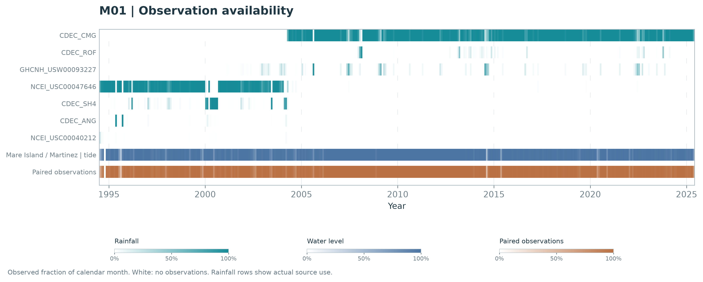](figures/M01_coverage.png)

## Unit M02

Coastal series: Richmond. Sources: `NOAA_9414863`.

[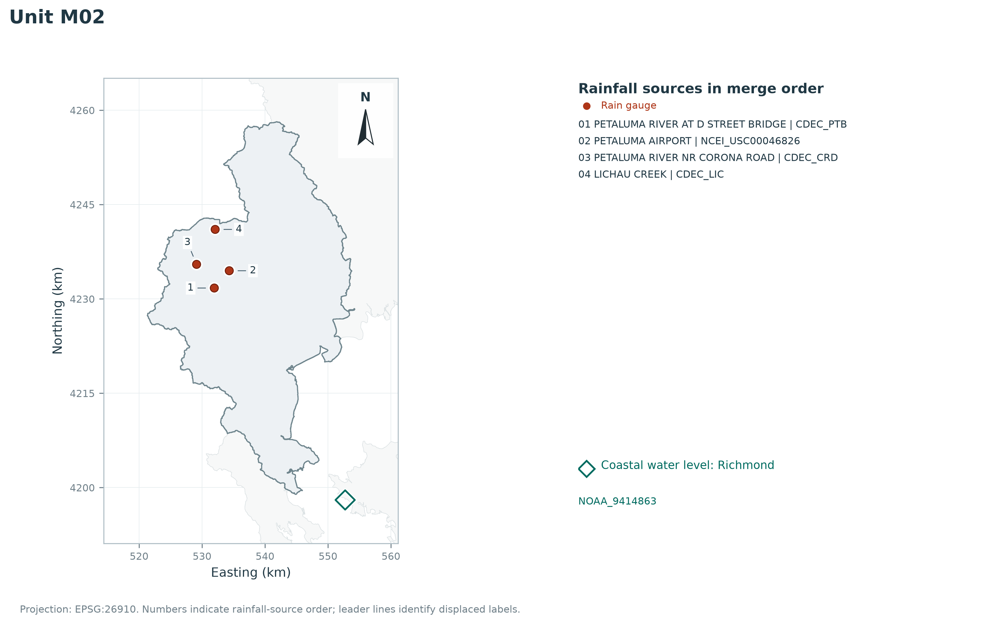](figures/M02_stations.png)

| Priority | Rainfall station | ID | First use | Last use |
|--:|:--|:--|:--|:--|
| 1 | PETALUMA RIVER AT D STREET BRIDGE | `CDEC_PTB` | 2003-09-17 | 2026-08-31 |
| 2 | PETALUMA AIRPORT | `NCEI_USC00046826` | 1996-01-01 | 2026-05-29 |
| 3 | PETALUMA RIVER NR CORONA ROAD | `CDEC_CRD` | 1998-02-28 | 2020-08-04 |
| 4 | LICHAU CREEK | `CDEC_LIC` | 1997-10-31 | 2020-08-20 |

[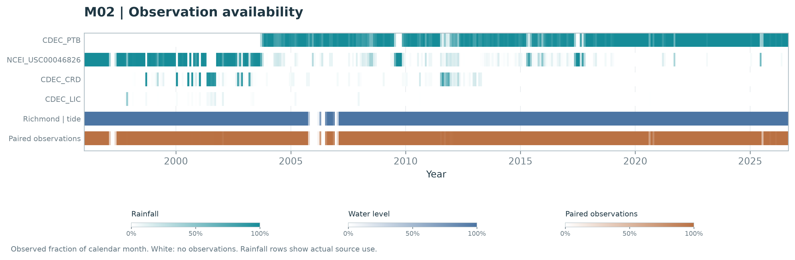](figures/M02_coverage.png)

## Unit M03

Coastal series: San Francisco. Sources: `NOAA_9414290`.

[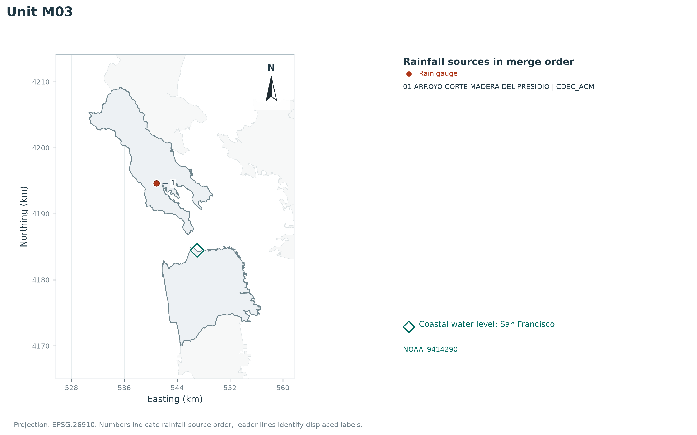](figures/M03_stations.png)

| Priority | Rainfall station | ID | First use | Last use |
|--:|:--|:--|:--|:--|
| 1 | ARROYO CORTE MADERA DEL PRESIDIO | `CDEC_ACM` | 2000-01-10 | 2026-08-25 |

[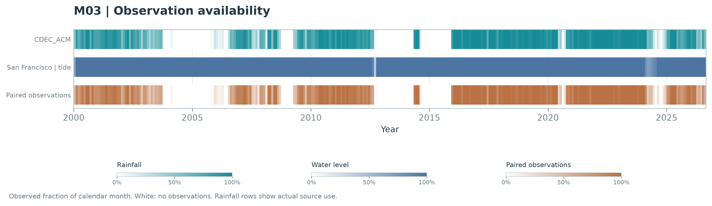](figures/M03_coverage.png)

## Unit M04

Coastal series: Redwood City. Sources: `NOAA_9414523`.

[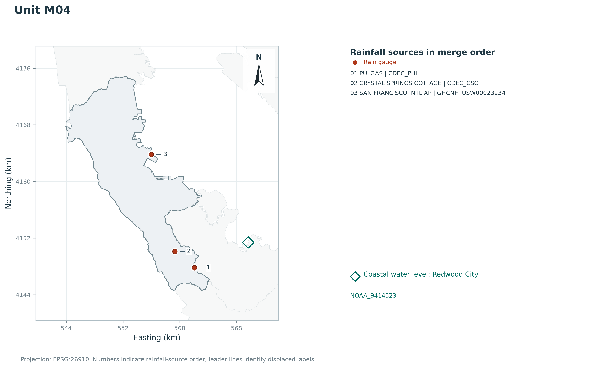](figures/M04_stations.png)

| Priority | Rainfall station | ID | First use | Last use |
|--:|:--|:--|:--|:--|
| 1 | PULGAS | `CDEC_PUL` | 2014-06-19 | 2026-08-31 |
| 2 | CRYSTAL SPRINGS COTTAGE | `CDEC_CSC` | 1999-04-20 | 2026-07-01 |
| 3 | SAN FRANCISCO INTL AP | `GHCNH_USW00023234` | 1975-01-04 | 2026-06-23 |

[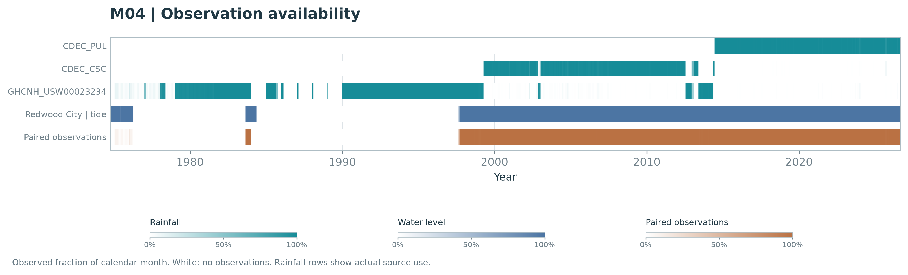](figures/M04_coverage.png)

## Unit M05

Coastal series: Redwood City. Sources: `NOAA_9414523`.

[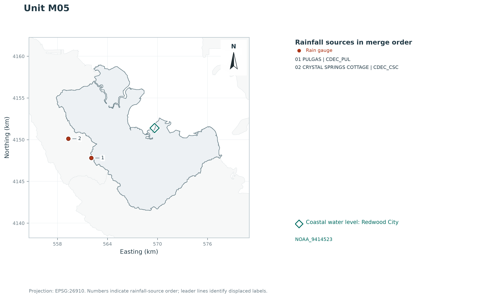](figures/M05_stations.png)

| Priority | Rainfall station | ID | First use | Last use |
|--:|:--|:--|:--|:--|
| 1 | PULGAS | `CDEC_PUL` | 2014-06-19 | 2026-08-31 |
| 2 | CRYSTAL SPRINGS COTTAGE | `CDEC_CSC` | 1999-04-20 | 2026-07-01 |

[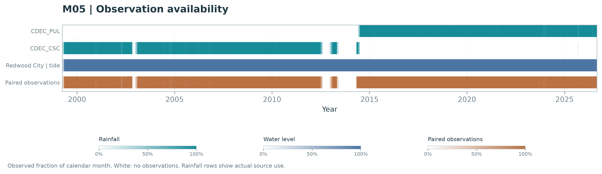](figures/M05_coverage.png)

## Unit M06

Coastal series: Alviso. Sources: `NOAA_9414575`, `USGS_372750122012701`.

[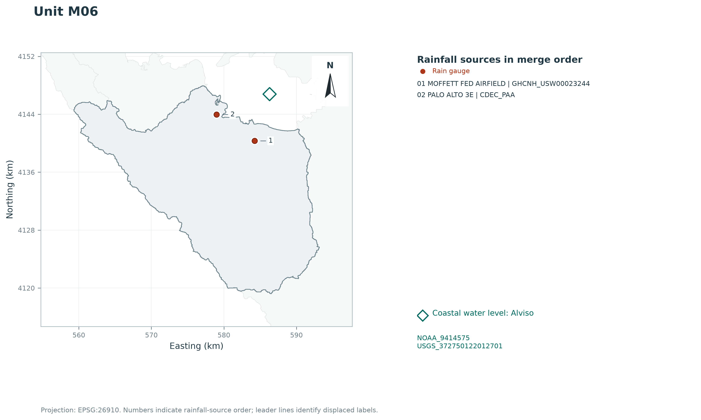](figures/M06_stations.png)

| Priority | Rainfall station | ID | First use | Last use |
|--:|:--|:--|:--|:--|
| 1 | MOFFETT FED AIRFIELD | `GHCNH_USW00023244` | 2004-09-19 | 2026-09-04 |
| 2 | PALO ALTO 3E | `CDEC_PAA` | 2000-01-06 | 2024-07-18 |

[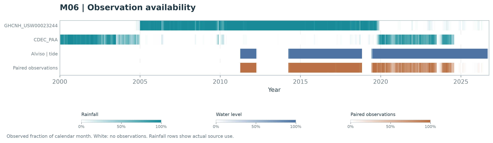](figures/M06_coverage.png)

## Unit M07

Coastal series: Alviso. Sources: `NOAA_9414575`, `USGS_372750122012701`.

[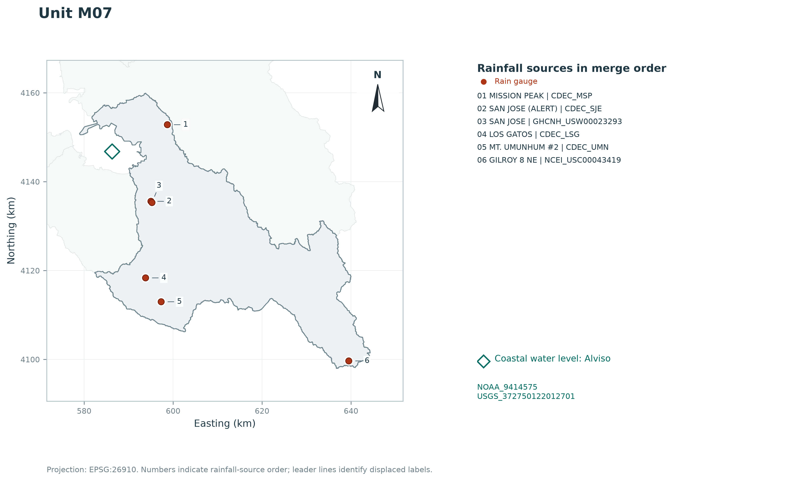](figures/M07_stations.png)

| Priority | Rainfall station | ID | First use | Last use |
|--:|:--|:--|:--|:--|
| 1 | MISSION PEAK | `CDEC_MSP` | 1996-10-01 | 2026-09-15 |
| 2 | SAN JOSE (ALERT) | `CDEC_SJE` | 2002-01-24 | 2022-12-16 |
| 3 | SAN JOSE | `GHCNH_USW00023293` | 2001-11-25 | 2026-06-08 |
| 4 | LOS GATOS | `CDEC_LSG` | 1994-07-01 | 2026-04-22 |
| 5 | MT. UMUNHUM #2 | `CDEC_UMN` | 2000-05-04 | 2013-02-20 |
| 6 | GILROY 8 NE | `NCEI_USC00043419` | 1983-11-03 | 2025-11-20 |

[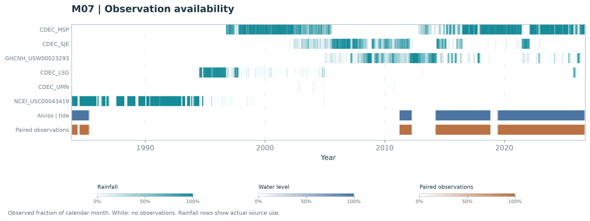](figures/M07_coverage.png)

## Unit M08

Coastal series: Redwood City. Sources: `NOAA_9414523`.

[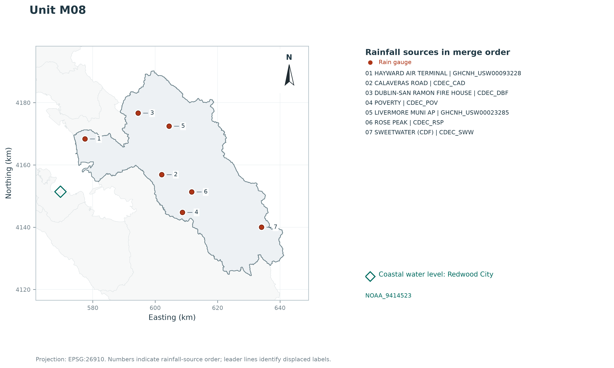](figures/M08_stations.png)

| Priority | Rainfall station | ID | First use | Last use |
|--:|:--|:--|:--|:--|
| 1 | HAYWARD AIR TERMINAL | `GHCNH_USW00093228` | 2001-02-22 | 2026-08-31 |
| 2 | CALAVERAS ROAD | `CDEC_CAD` | 2004-11-12 | 2026-03-12 |
| 3 | DUBLIN-SAN RAMON FIRE HOUSE | `CDEC_DBF` | 2004-04-08 | 2025-11-20 |
| 4 | POVERTY | `CDEC_POV` | 2025-01-01 | 2025-01-01 |
| 5 | LIVERMORE MUNI AP | `GHCNH_USW00023285` | 2001-02-10 | 2004-03-30 |
| 6 | ROSE PEAK | `CDEC_RSP` | 1997-04-28 | 2004-09-20 |
| 9 | SWEETWATER (CDF) | `CDEC_SWW` | 1991-09-01 | 2000-09-26 |

[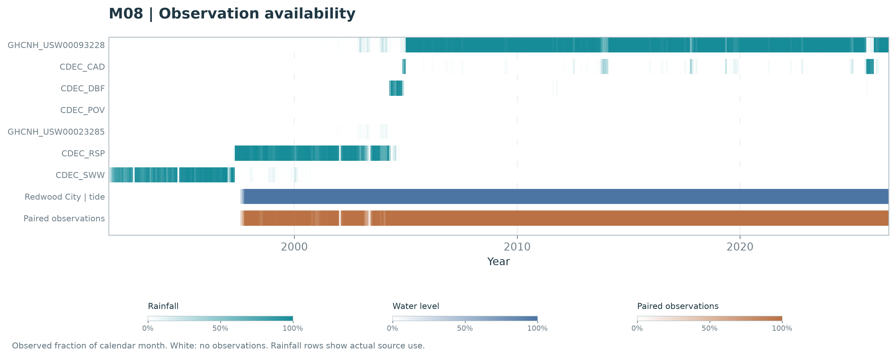](figures/M08_coverage.png)

## Unit M09

Coastal series: Alameda. Sources: `NOAA_9414750`.

[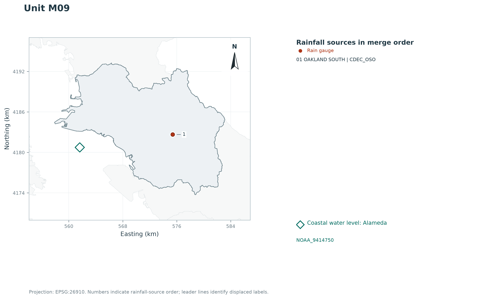](figures/M09_stations.png)

| Priority | Rainfall station | ID | First use | Last use |
|--:|:--|:--|:--|:--|
| 1 | OAKLAND SOUTH | `CDEC_OSO` | 1992-11-01 | 2026-08-31 |

[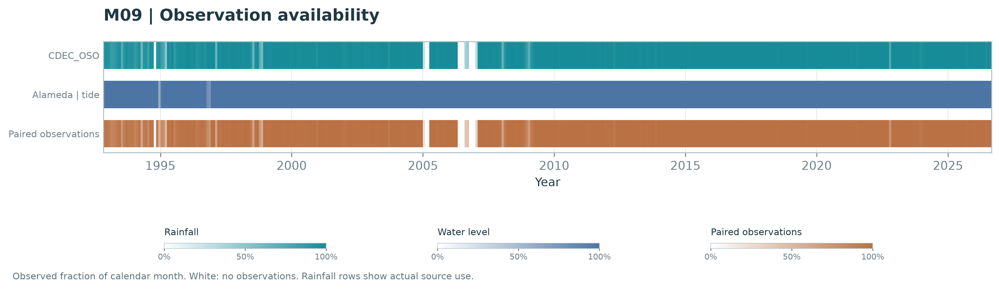](figures/M09_coverage.png)

## Unit M10

Coastal series: Redwood City. Sources: `NOAA_9414523`.

[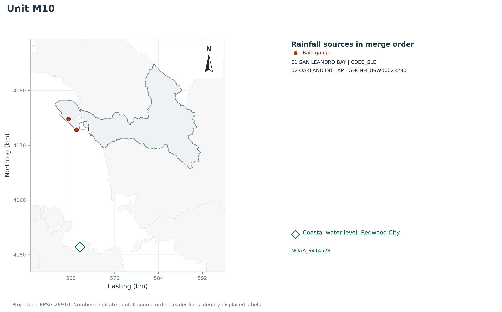](figures/M10_stations.png)

| Priority | Rainfall station | ID | First use | Last use |
|--:|:--|:--|:--|:--|
| 1 | SAN LEANDRO BAY | `CDEC_SLE` | 1996-11-07 | 2023-04-30 |
| 2 | OAKLAND INTL AP | `GHCNH_USW00023230` | 1974-10-28 | 2026-08-31 |

[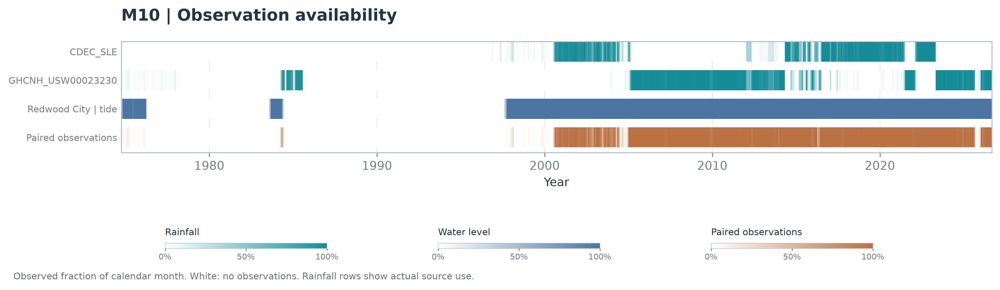](figures/M10_coverage.png)

## Unit M11

Coastal series: Richmond. Sources: `NOAA_9414863`.

[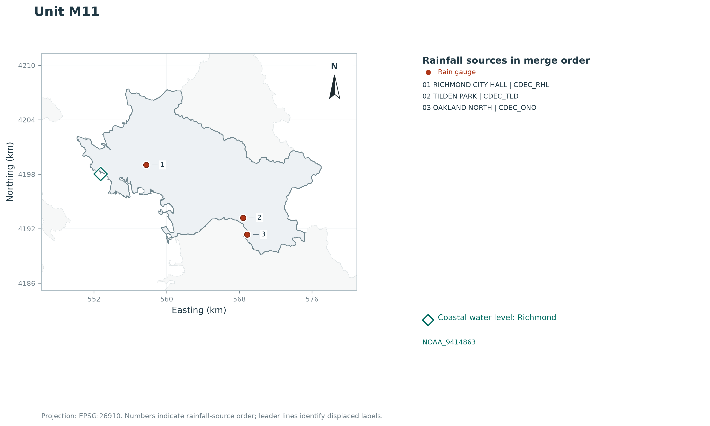](figures/M11_stations.png)

| Priority | Rainfall station | ID | First use | Last use |
|--:|:--|:--|:--|:--|
| 1 | RICHMOND CITY HALL | `CDEC_RHL` | 2005-01-22 | 2026-08-31 |
| 2 | TILDEN PARK | `CDEC_TLD` | 2004-04-08 | 2026-07-01 |
| 3 | OAKLAND NORTH | `CDEC_ONO` | 1996-01-01 | 2025-12-29 |

[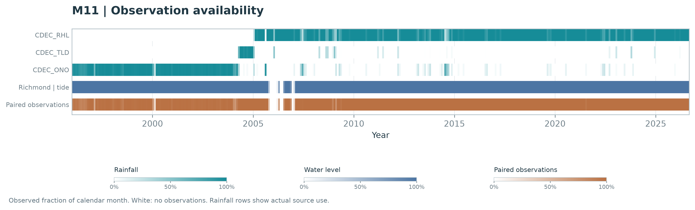](figures/M11_coverage.png)
