# San Francisco Bay

Eleven units represent the bay's coastal catchment groups. All water levels enter inference in NAVD88. The analysis clock is fixed Pacific Standard Time (UTC-8), with October-to-September water years.

| Analysis units | Observation interval | Vertical reference |
|--:|:--|:--|
| 11 | Hourly; intact 6 h rainfall supplements | NAVD88 |

[Study area](#study-area) · [Units](#analysis-units) · [Coverage](#observation-coverage) · [Stations](#station-catalogue) · [Run](#run)

## Study area

<p align="center">
  <a href="figures/01_study_area.png">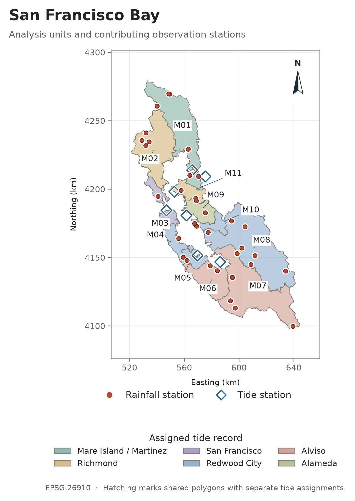</a><br>
  <sub>Analysis units and observation stations.</sub>
</p>

## Analysis units

| Unit | Component subcatchments | Tide record |
|:--|:--|:--|
| M01 | SB07, SB08, SB09, SB10 | Mare Island / Martinez |
| M02 | SB03, SB04, SB05, SB06 | Richmond |
| M03 | SB01, SB02, SB31 | San Francisco |
| M04 | SB30, SB29 | Redwood City |
| M05 | SB28, SB27 | Redwood City |
| M06 | SB26, SB25, SB24, SB23 | Alviso |
| M07 | SB22, SB21, SB20 | Alviso |
| M08 | SB18, SB19 | Redwood City |
| M09 | SB13, SB14, SB15 | Alameda |
| M10 | SB16, SB17 | Redwood City |
| M11 | SB12, SB11 | Richmond |

<details markdown="1">
<summary>Partitioning principles</summary>

The 31 source subcatchments, SB01–SB31, follow drainage outlets to the bay or adjacent coastal waters. Watershed divides are constrained by the DEM, river network and HUC12 boundaries. The final partition groups these subcatchments into 11 coastal-drainage units, as listed below.

During source-subcatchment delineation, drainage areas below 2 km² are joined to the neighbour with the longest shared boundary. Areas below 50 km² are preferentially joined to neighbouring small catchments below 120 km². The final 11 analysis groups retain the component IDs in the table.

Each group has a specified rainfall-source sequence and a coastal water-level record. A tide record can serve several groups: M04, M05, M08 and M10 use Redwood City, for example, but retain separate rainfall records and compound-event models. Group membership therefore carries information beyond the tide-station assignment.

See [Methods](../shared/methods.md#analysis-units) for the common partitioning principles.

</details>

<details markdown="1">
<summary>Station assignment diagram</summary>

<p align="center">
  <a href="figures/02_station_assignments.png">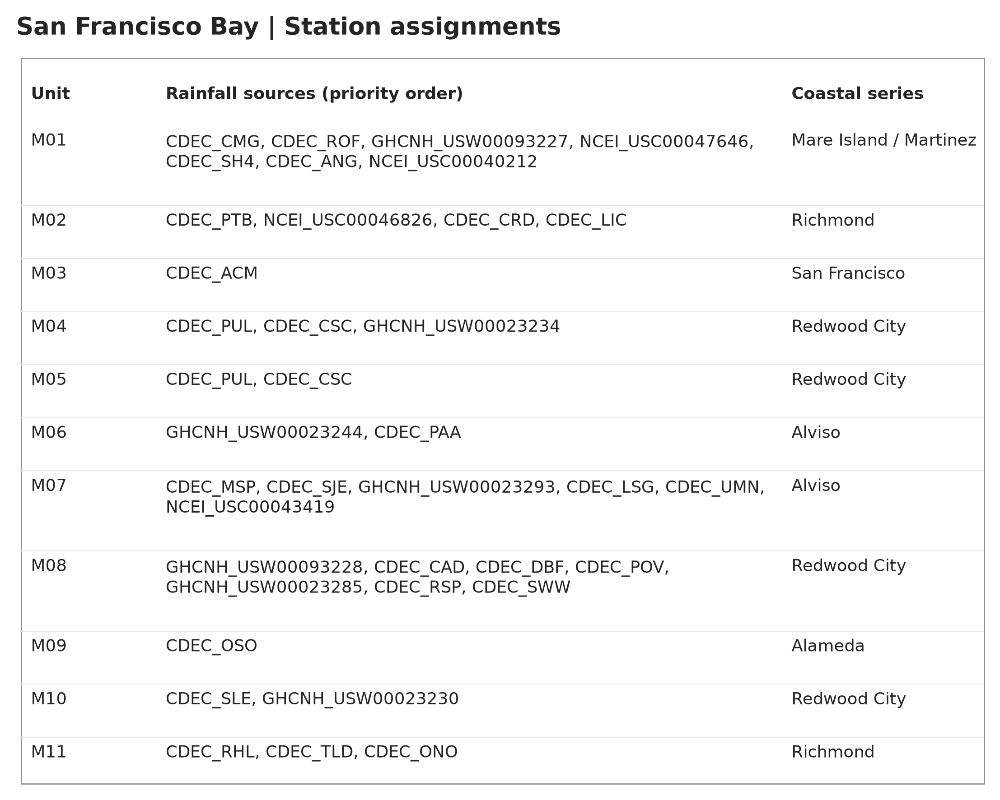</a><br>
  <sub>Rainfall and coastal water-level assignments by unit.</sub>
</p>

</details>

## Observation coverage

<p align="center">
  <a href="figures/03_observation_coverage.png">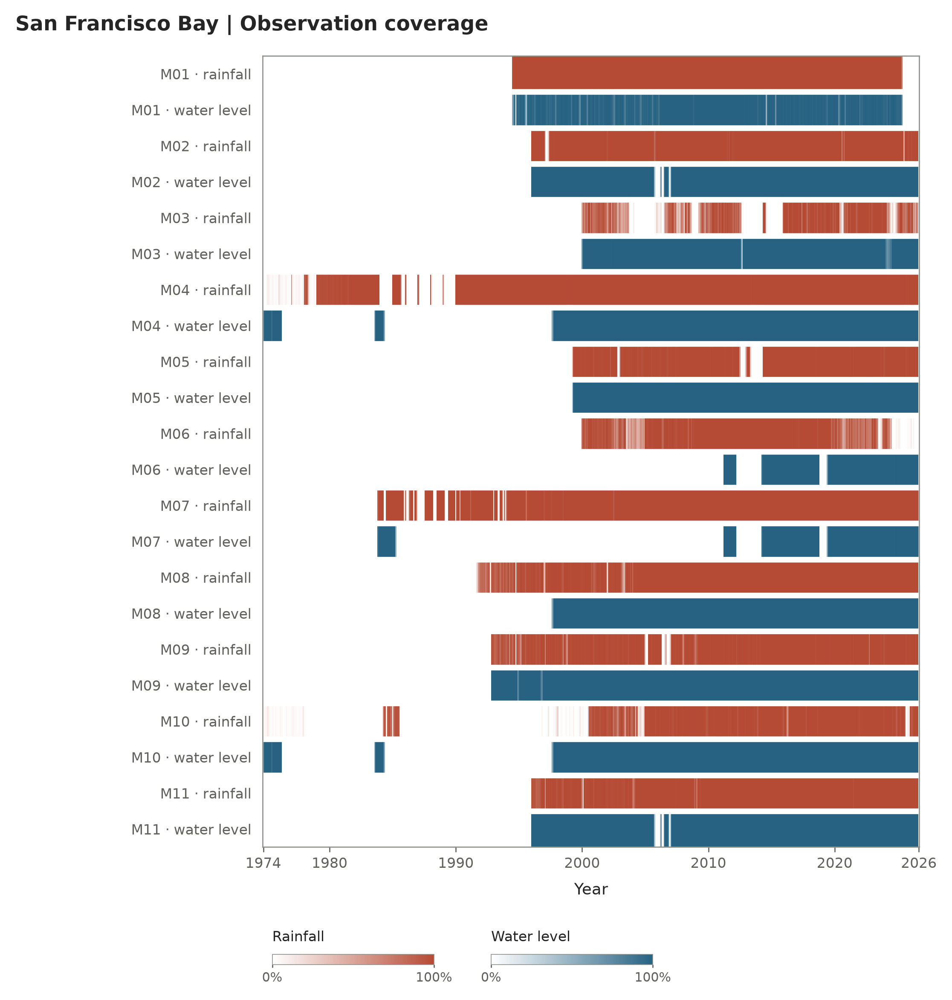</a><br>
  <sub>Monthly coverage of the archived compound-input records.</sub>
</p>

Coverage refers to the archived compound-input record. Colour intensity represents the observed fraction of a calendar month; white indicates missing observations. Rainfall rows show actual source use. Annual-frequency analysis uses independently screened full records.

## Station catalogue

[M01](#unit-m01) · [M02](#unit-m02) · [M03](#unit-m03) · [M04](#unit-m04) · [M05](#unit-m05) · [M06](#unit-m06) · [M07](#unit-m07) · [M08](#unit-m08) · [M09](#unit-m09) · [M10](#unit-m10) · [M11](#unit-m11)

First and last use refer to actual station contributions; gaps appear in the coverage figures.

<details markdown="1">
<summary><strong>Unit M01</strong> · Mare Island / Martinez · 7 rainfall stations</summary>

### Unit M01

Tide station: Mare Island / Martinez.<br>
ID: `NOAA_9415218`, `GESLA_CDWR_MRZ`.

#### Rainfall sources

| Priority | Rainfall station | ID | First use | Last use |
|--:|:--|:--|:--|:--|
| 1 | CUMMINGS PEAK | `CDEC_CMG` | 2004-04-08 | 2025-05-24 |
| 2 | RODEO FIRE DEPARTMENT | `CDEC_ROF` | 2005-12-23 | 2024-07-01 |
| 3 | NAPA CO AP | `GHCNH_USW00093227` | 2001-02-10 | 2023-11-14 |
| 4 | SAINT HELENA 4 WSW | `NCEI_USC00047646` | 1994-07-08 | 2022-06-01 |
| 5 | ST. HELENA 4WSW | `CDEC_SH4` | 1995-02-01 | 2004-04-02 |
| 6 | ANGWIN | `CDEC_ANG` | 1995-02-01 | 2004-03-27 |
| 7 | ANGWIN PACIFIC UNION COLLEGE | `NCEI_USC00040212` | 1994-07-02 | 2004-03-25 |

#### Station locations and coverage

<p align="center">
  <a href="figures/M01_stations.png">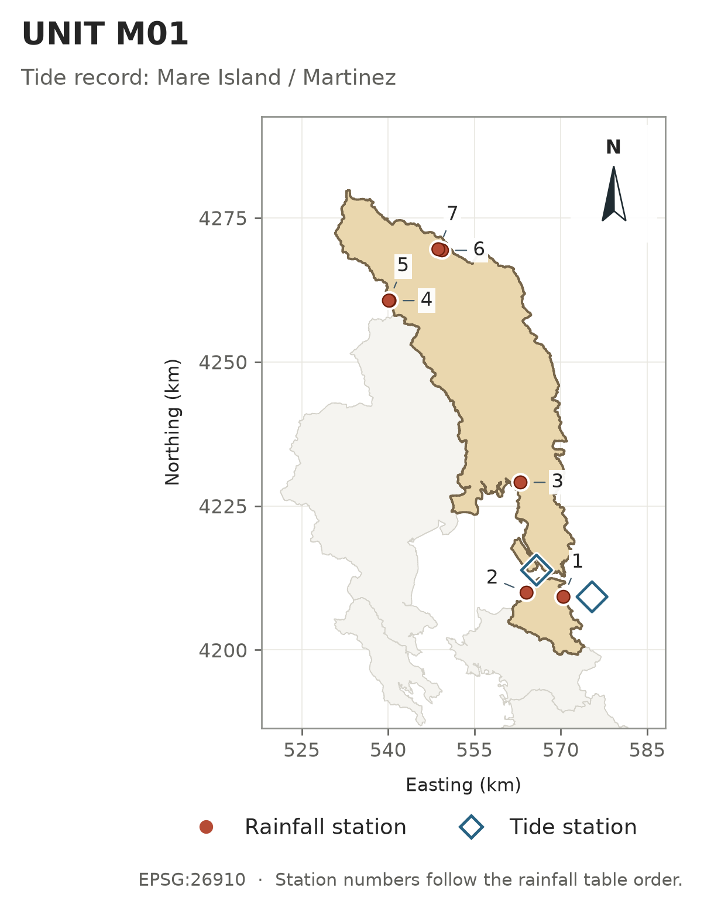</a><br>
  <sub>Unit M01. Station locations and rainfall-source order.</sub>
</p>

<p align="center">
  <a href="figures/M01_coverage.png">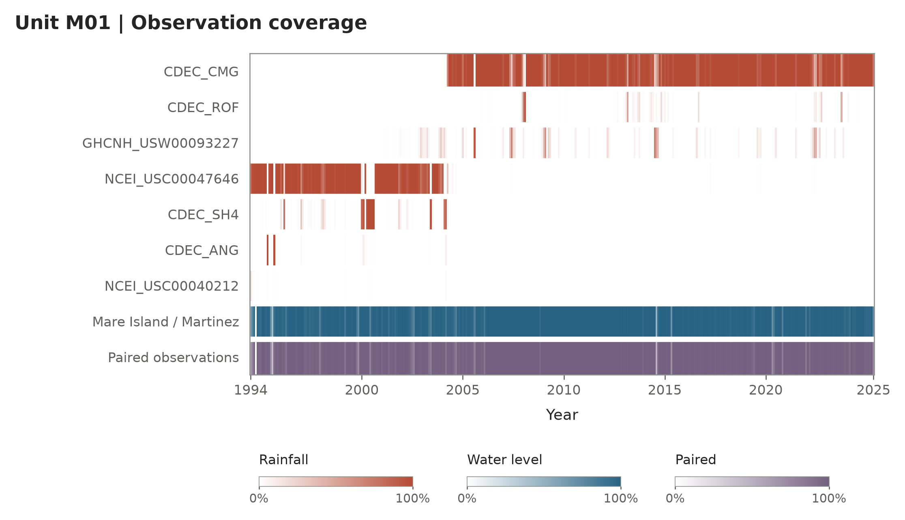</a><br>
  <sub>Unit M01. Monthly availability of contributing rainfall, water-level and paired observations.</sub>
</p>

</details>

<details markdown="1">
<summary><strong>Unit M02</strong> · Richmond · 4 rainfall stations</summary>

### Unit M02

Tide station: Richmond.<br>
ID: `NOAA_9414863`.

#### Rainfall sources

| Priority | Rainfall station | ID | First use | Last use |
|--:|:--|:--|:--|:--|
| 1 | PETALUMA RIVER AT D STREET BRIDGE | `CDEC_PTB` | 2003-09-17 | 2026-08-31 |
| 2 | PETALUMA AIRPORT | `NCEI_USC00046826` | 1996-01-01 | 2026-05-29 |
| 3 | PETALUMA RIVER NR CORONA ROAD | `CDEC_CRD` | 1998-02-28 | 2020-08-04 |
| 4 | LICHAU CREEK | `CDEC_LIC` | 1997-10-31 | 2020-08-20 |

#### Station locations and coverage

<p align="center">
  <a href="figures/M02_stations.png">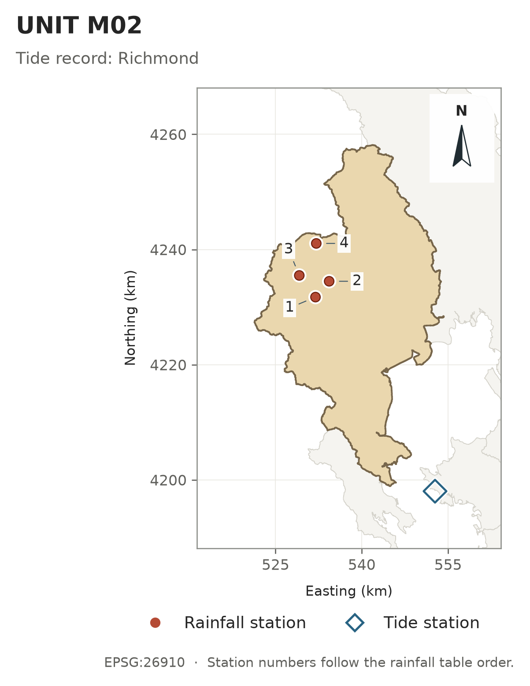</a><br>
  <sub>Unit M02. Station locations and rainfall-source order.</sub>
</p>

<p align="center">
  <a href="figures/M02_coverage.png">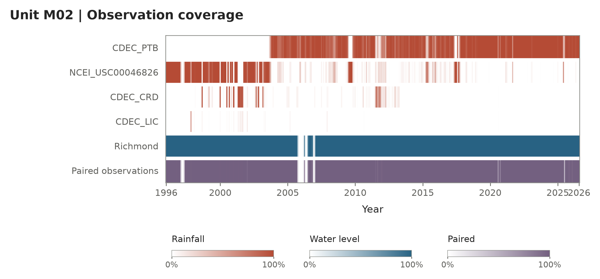</a><br>
  <sub>Unit M02. Monthly availability of contributing rainfall, water-level and paired observations.</sub>
</p>

</details>

<details markdown="1">
<summary><strong>Unit M03</strong> · San Francisco · 1 rainfall station</summary>

### Unit M03

Tide station: San Francisco.<br>
ID: `NOAA_9414290`.

#### Rainfall sources

| Priority | Rainfall station | ID | First use | Last use |
|--:|:--|:--|:--|:--|
| 1 | ARROYO CORTE MADERA DEL PRESIDIO | `CDEC_ACM` | 2000-01-10 | 2026-08-25 |

#### Station locations and coverage

<p align="center">
  <a href="figures/M03_stations.png">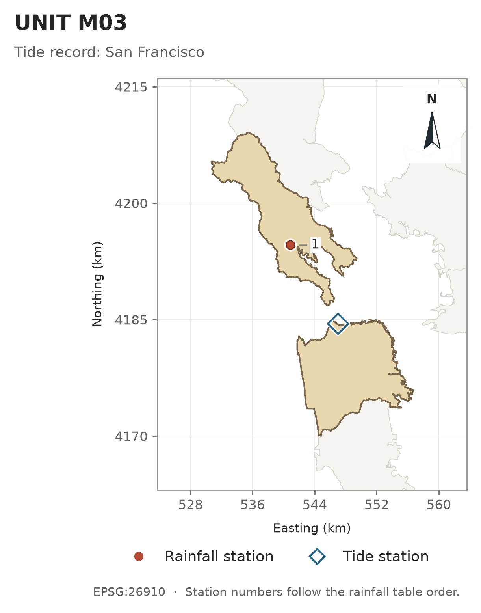</a><br>
  <sub>Unit M03. Station locations and rainfall-source order.</sub>
</p>

<p align="center">
  <a href="figures/M03_coverage.png">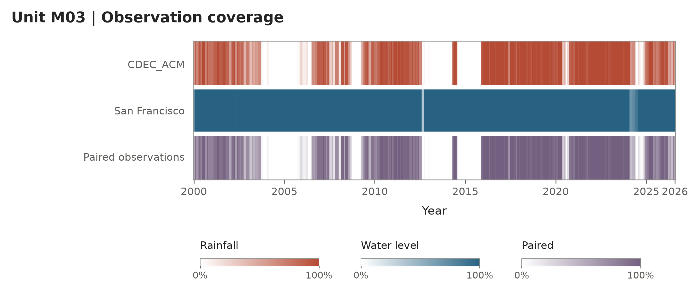</a><br>
  <sub>Unit M03. Monthly availability of contributing rainfall, water-level and paired observations.</sub>
</p>

</details>

<details markdown="1">
<summary><strong>Unit M04</strong> · Redwood City · 3 rainfall stations</summary>

### Unit M04

Tide station: Redwood City.<br>
ID: `NOAA_9414523`.

#### Rainfall sources

| Priority | Rainfall station | ID | First use | Last use |
|--:|:--|:--|:--|:--|
| 1 | PULGAS | `CDEC_PUL` | 2014-06-19 | 2026-08-31 |
| 2 | CRYSTAL SPRINGS COTTAGE | `CDEC_CSC` | 1999-04-20 | 2026-07-01 |
| 3 | SAN FRANCISCO INTL AP | `GHCNH_USW00023234` | 1975-01-04 | 2026-06-23 |

#### Station locations and coverage

<p align="center">
  <a href="figures/M04_stations.png">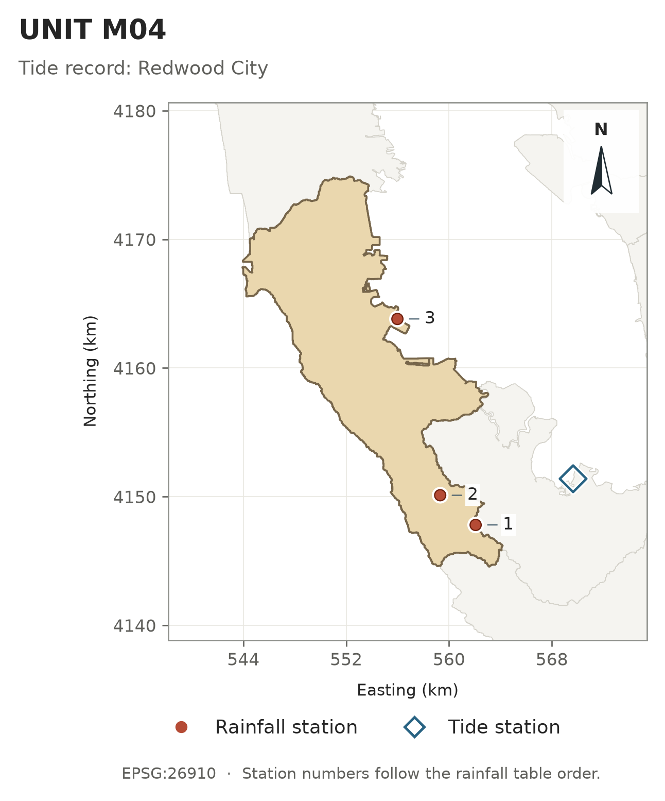</a><br>
  <sub>Unit M04. Station locations and rainfall-source order.</sub>
</p>

<p align="center">
  <a href="figures/M04_coverage.png">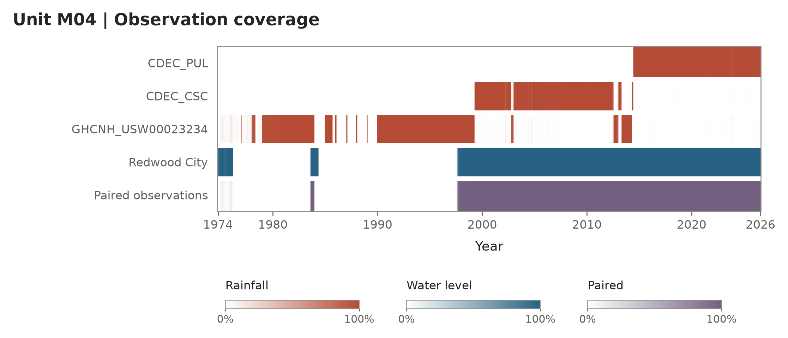</a><br>
  <sub>Unit M04. Monthly availability of contributing rainfall, water-level and paired observations.</sub>
</p>

</details>

<details markdown="1">
<summary><strong>Unit M05</strong> · Redwood City · 2 rainfall stations</summary>

### Unit M05

Tide station: Redwood City.<br>
ID: `NOAA_9414523`.

#### Rainfall sources

| Priority | Rainfall station | ID | First use | Last use |
|--:|:--|:--|:--|:--|
| 1 | PULGAS | `CDEC_PUL` | 2014-06-19 | 2026-08-31 |
| 2 | CRYSTAL SPRINGS COTTAGE | `CDEC_CSC` | 1999-04-20 | 2026-07-01 |

#### Station locations and coverage

<p align="center">
  <a href="figures/M05_stations.png">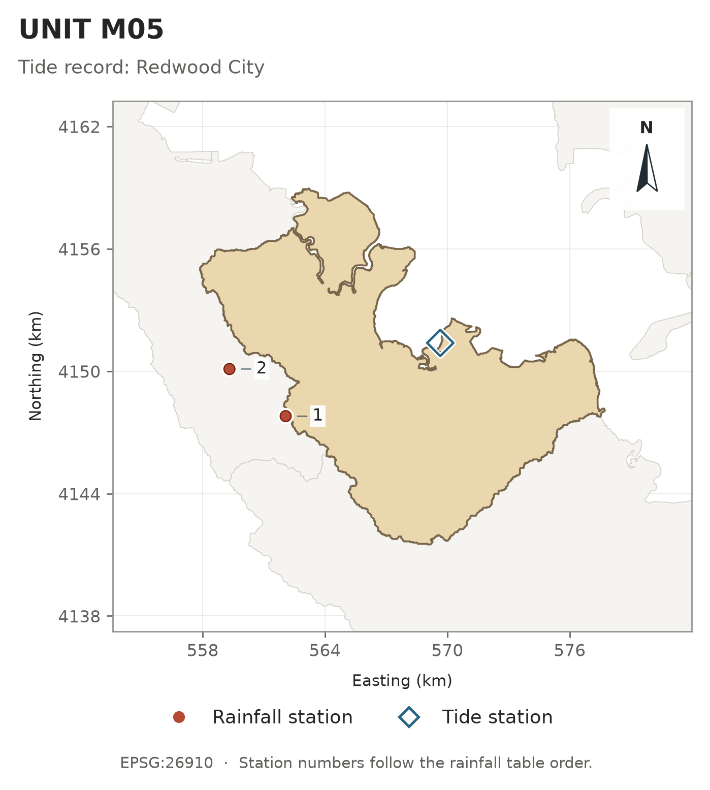</a><br>
  <sub>Unit M05. Station locations and rainfall-source order.</sub>
</p>

<p align="center">
  <a href="figures/M05_coverage.png">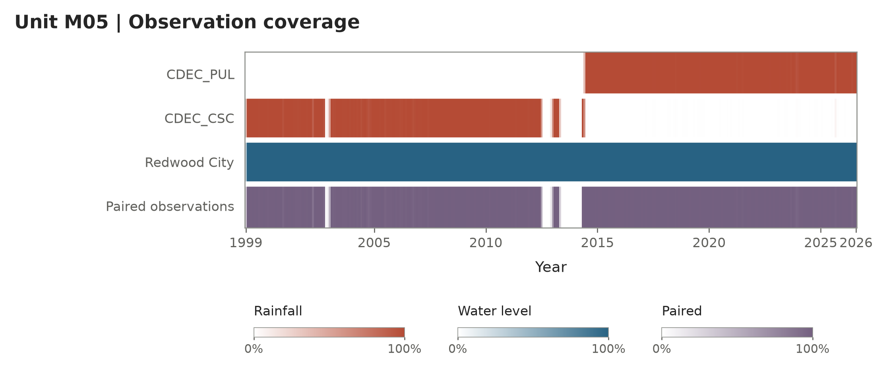</a><br>
  <sub>Unit M05. Monthly availability of contributing rainfall, water-level and paired observations.</sub>
</p>

</details>

<details markdown="1">
<summary><strong>Unit M06</strong> · Alviso · 2 rainfall stations</summary>

### Unit M06

Tide station: Alviso.<br>
ID: `NOAA_9414575`, `USGS_372750122012701`.

#### Rainfall sources

| Priority | Rainfall station | ID | First use | Last use |
|--:|:--|:--|:--|:--|
| 1 | MOFFETT FED AIRFIELD | `GHCNH_USW00023244` | 2004-09-19 | 2026-09-04 |
| 2 | PALO ALTO 3E | `CDEC_PAA` | 2000-01-06 | 2024-07-18 |

#### Station locations and coverage

<p align="center">
  <a href="figures/M06_stations.png">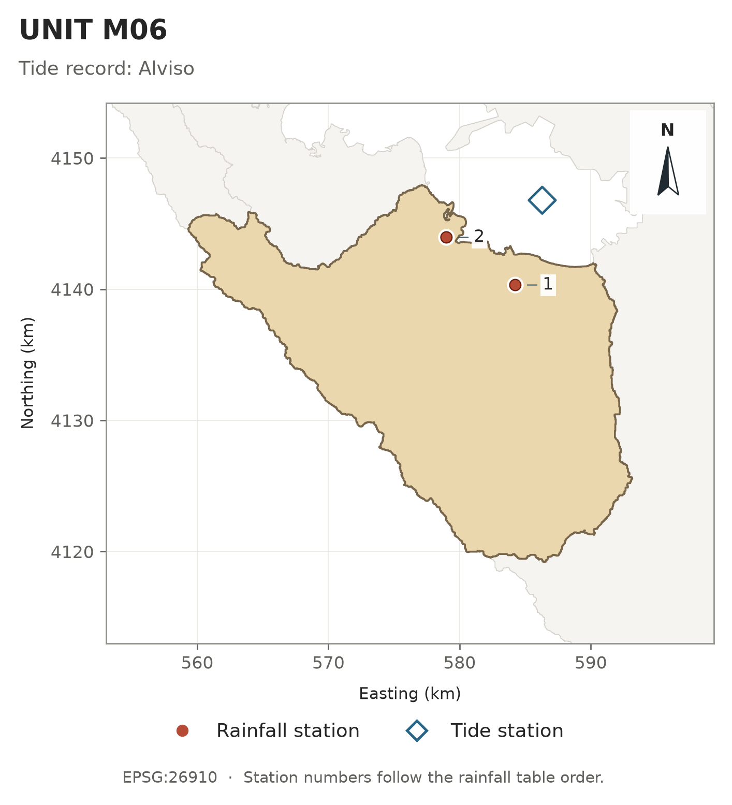</a><br>
  <sub>Unit M06. Station locations and rainfall-source order.</sub>
</p>

<p align="center">
  <a href="figures/M06_coverage.png">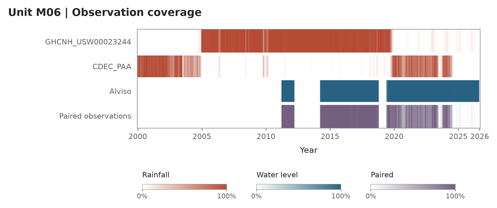</a><br>
  <sub>Unit M06. Monthly availability of contributing rainfall, water-level and paired observations.</sub>
</p>

</details>

<details markdown="1">
<summary><strong>Unit M07</strong> · Alviso · 6 rainfall stations</summary>

### Unit M07

Tide station: Alviso.<br>
ID: `NOAA_9414575`, `USGS_372750122012701`.

#### Rainfall sources

| Priority | Rainfall station | ID | First use | Last use |
|--:|:--|:--|:--|:--|
| 1 | MISSION PEAK | `CDEC_MSP` | 1996-10-01 | 2026-09-15 |
| 2 | SAN JOSE (ALERT) | `CDEC_SJE` | 2002-01-24 | 2022-12-16 |
| 3 | SAN JOSE | `GHCNH_USW00023293` | 2001-11-25 | 2026-06-08 |
| 4 | LOS GATOS | `CDEC_LSG` | 1994-07-01 | 2026-04-22 |
| 5 | MT. UMUNHUM #2 | `CDEC_UMN` | 2000-05-04 | 2013-02-20 |
| 6 | GILROY 8 NE | `NCEI_USC00043419` | 1983-11-03 | 2025-11-20 |

#### Station locations and coverage

<p align="center">
  <a href="figures/M07_stations.png">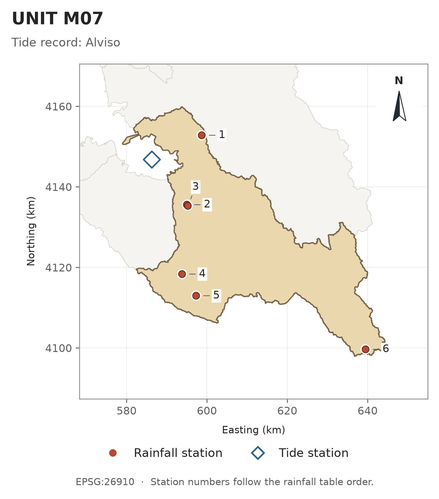</a><br>
  <sub>Unit M07. Station locations and rainfall-source order.</sub>
</p>

<p align="center">
  <a href="figures/M07_coverage.png">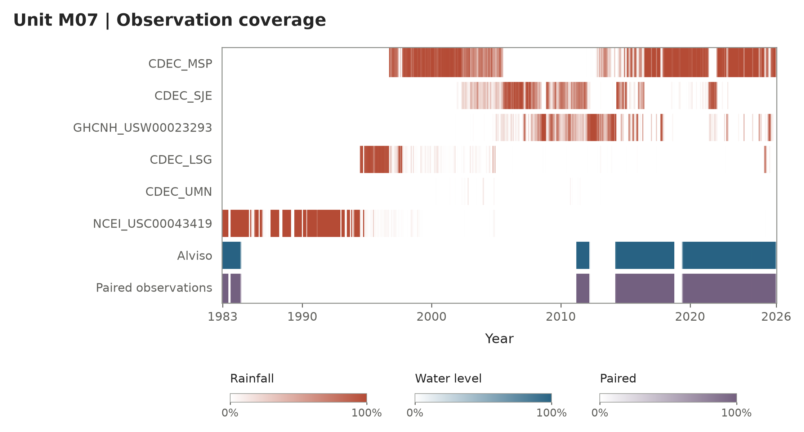</a><br>
  <sub>Unit M07. Monthly availability of contributing rainfall, water-level and paired observations.</sub>
</p>

</details>

<details markdown="1">
<summary><strong>Unit M08</strong> · Redwood City · 7 rainfall stations</summary>

### Unit M08

Tide station: Redwood City.<br>
ID: `NOAA_9414523`.

#### Rainfall sources

| Priority | Rainfall station | ID | First use | Last use |
|--:|:--|:--|:--|:--|
| 1 | HAYWARD AIR TERMINAL | `GHCNH_USW00093228` | 2001-02-22 | 2026-08-31 |
| 2 | CALAVERAS ROAD | `CDEC_CAD` | 2004-11-12 | 2026-03-12 |
| 3 | DUBLIN-SAN RAMON FIRE HOUSE | `CDEC_DBF` | 2004-04-08 | 2025-11-20 |
| 4 | POVERTY | `CDEC_POV` | 2025-01-01 | 2025-01-01 |
| 5 | LIVERMORE MUNI AP | `GHCNH_USW00023285` | 2001-02-10 | 2004-03-30 |
| 6 | ROSE PEAK | `CDEC_RSP` | 1997-04-28 | 2004-09-20 |
| 9 | SWEETWATER (CDF) | `CDEC_SWW` | 1991-09-01 | 2000-09-26 |

#### Station locations and coverage

<p align="center">
  <a href="figures/M08_stations.png">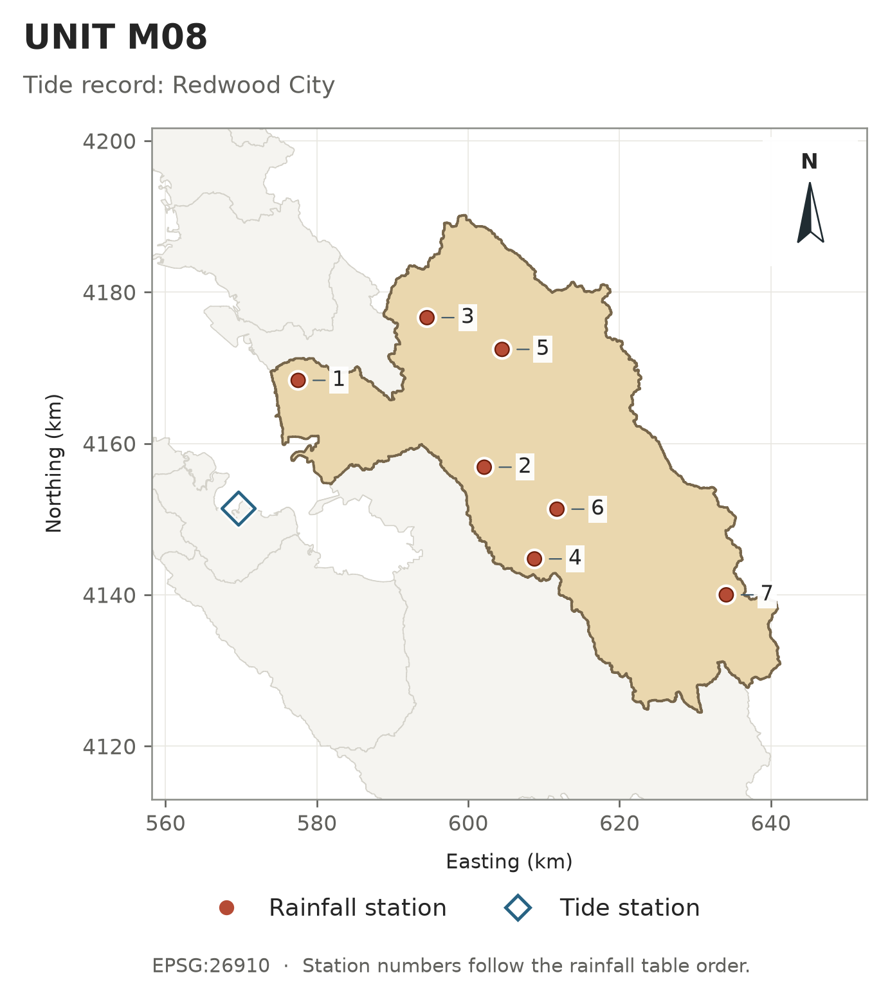</a><br>
  <sub>Unit M08. Station locations and rainfall-source order.</sub>
</p>

<p align="center">
  <a href="figures/M08_coverage.png">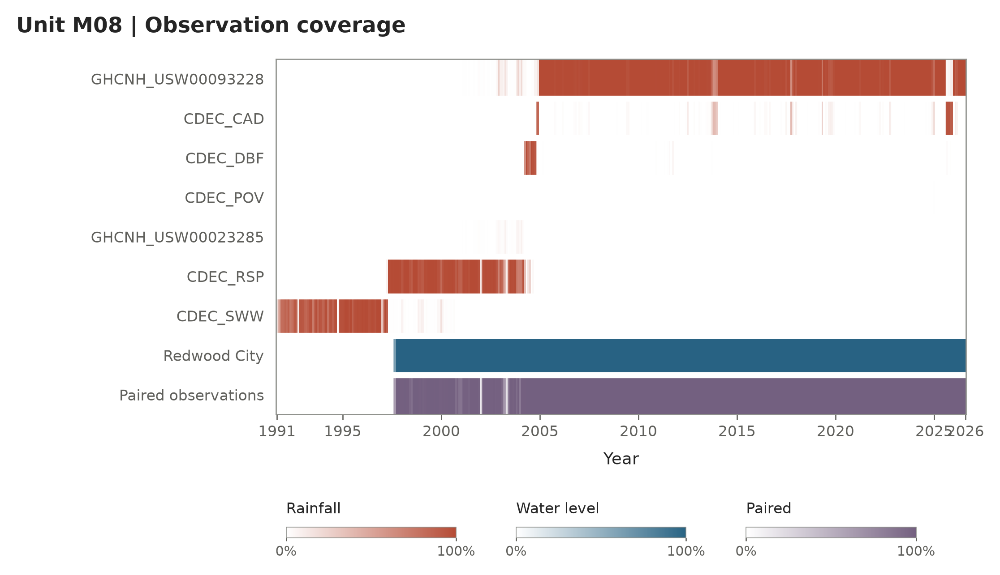</a><br>
  <sub>Unit M08. Monthly availability of contributing rainfall, water-level and paired observations.</sub>
</p>

</details>

<details markdown="1">
<summary><strong>Unit M09</strong> · Alameda · 1 rainfall station</summary>

### Unit M09

Tide station: Alameda.<br>
ID: `NOAA_9414750`.

#### Rainfall sources

| Priority | Rainfall station | ID | First use | Last use |
|--:|:--|:--|:--|:--|
| 1 | OAKLAND SOUTH | `CDEC_OSO` | 1992-11-01 | 2026-08-31 |

#### Station locations and coverage

<p align="center">
  <a href="figures/M09_stations.png">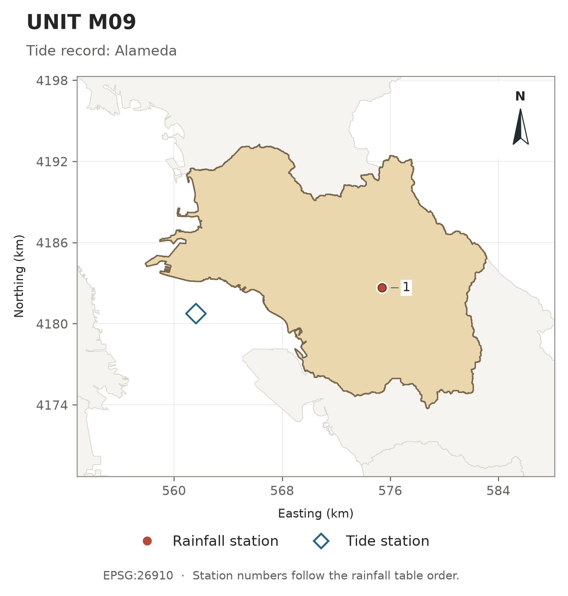</a><br>
  <sub>Unit M09. Station locations and rainfall-source order.</sub>
</p>

<p align="center">
  <a href="figures/M09_coverage.png">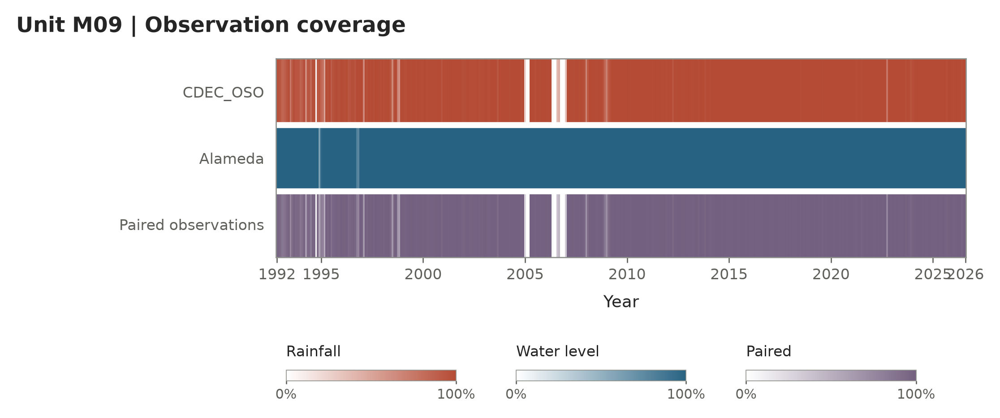</a><br>
  <sub>Unit M09. Monthly availability of contributing rainfall, water-level and paired observations.</sub>
</p>

</details>

<details markdown="1">
<summary><strong>Unit M10</strong> · Redwood City · 2 rainfall stations</summary>

### Unit M10

Tide station: Redwood City.<br>
ID: `NOAA_9414523`.

#### Rainfall sources

| Priority | Rainfall station | ID | First use | Last use |
|--:|:--|:--|:--|:--|
| 1 | SAN LEANDRO BAY | `CDEC_SLE` | 1996-11-07 | 2023-04-30 |
| 2 | OAKLAND INTL AP | `GHCNH_USW00023230` | 1974-10-28 | 2026-08-31 |

#### Station locations and coverage

<p align="center">
  <a href="figures/M10_stations.png">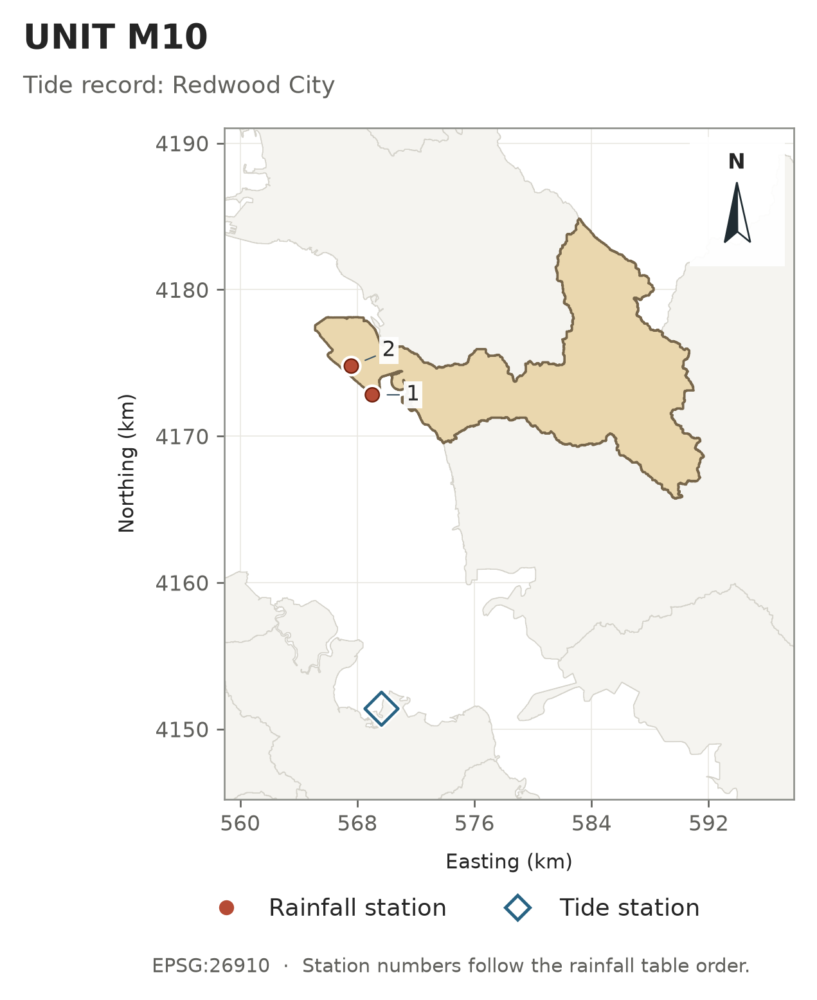</a><br>
  <sub>Unit M10. Station locations and rainfall-source order.</sub>
</p>

<p align="center">
  <a href="figures/M10_coverage.png">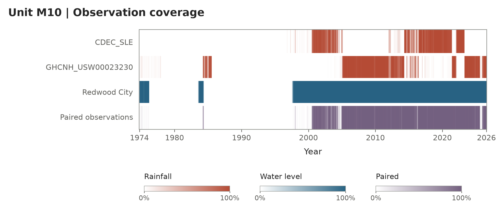</a><br>
  <sub>Unit M10. Monthly availability of contributing rainfall, water-level and paired observations.</sub>
</p>

</details>

<details markdown="1">
<summary><strong>Unit M11</strong> · Richmond · 3 rainfall stations</summary>

### Unit M11

Tide station: Richmond.<br>
ID: `NOAA_9414863`.

#### Rainfall sources

| Priority | Rainfall station | ID | First use | Last use |
|--:|:--|:--|:--|:--|
| 1 | RICHMOND CITY HALL | `CDEC_RHL` | 2005-01-22 | 2026-08-31 |
| 2 | TILDEN PARK | `CDEC_TLD` | 2004-04-08 | 2026-07-01 |
| 3 | OAKLAND NORTH | `CDEC_ONO` | 1996-01-01 | 2025-12-29 |

#### Station locations and coverage

<p align="center">
  <a href="figures/M11_stations.png">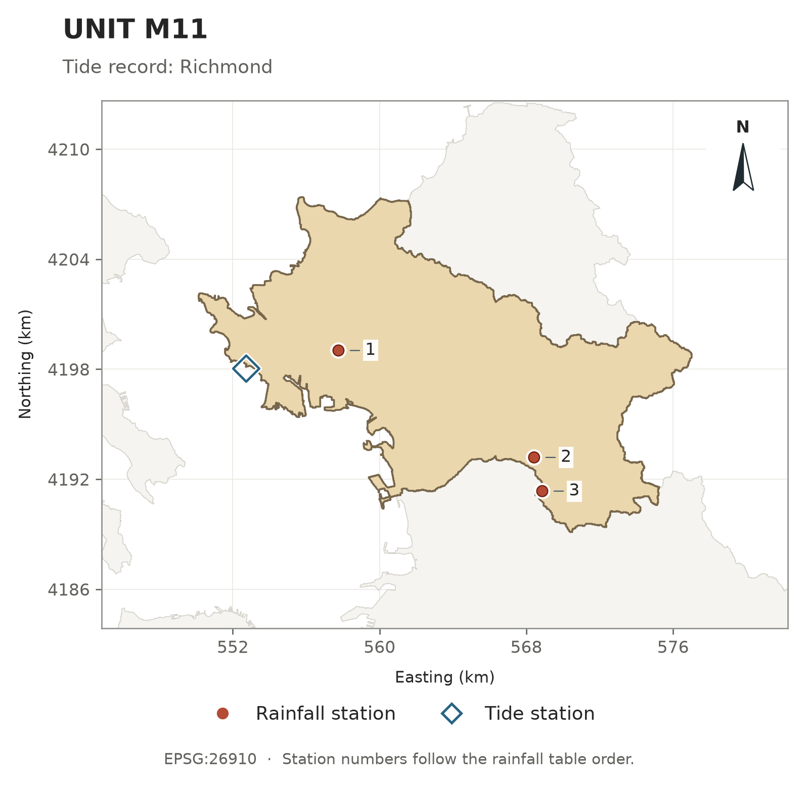</a><br>
  <sub>Unit M11. Station locations and rainfall-source order.</sub>
</p>

<p align="center">
  <a href="figures/M11_coverage.png">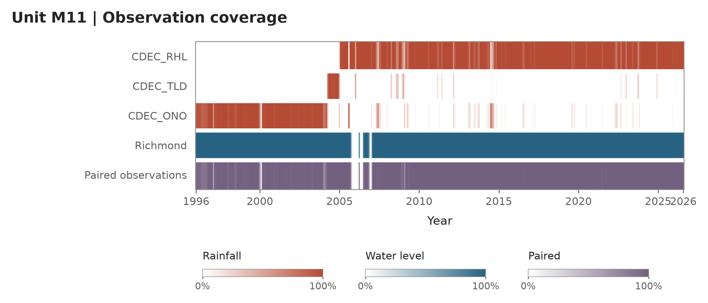</a><br>
  <sub>Unit M11. Monthly availability of contributing rainfall, water-level and paired observations.</sub>
</p>

</details>

## Regional settings

- Hourly rainfall follows the declared source priority. Intact six-hour reports can fill wholly missing nonoverlapping blocks; they are not disaggregated.
- Twelve-hour event separation, same-window rainfall/water pairing, rainfall R95, and 72-hour water-peak declustering define the compound population.
- S1 uses complete moving-24-hour rainfall maxima from the full available source record. Reviewed isolated spikes are excluded for the declared stations.
- S2 uses each tide station's complete record with documented quality exclusions and explicit partial-year selection.
- Alviso's annual frequency curve transfers from Redwood City using accepted concurrent annual maxima from 2019 onward. The historical Alviso tie is an engineering reference.
- Regular rainfall and coastal peak times occur at hour 13. Phase cases apply the same relative offsets as the other regions.

## Run

From the repository root, install the package and run:

```sh
python -m pip install -e "."
python SanF/run_analysis.py --manifest ../private/san_francisco/manifest.json --output ../outputs/san_francisco
```

[run_analysis.py](run_analysis.py) executes steps 01–05: preparation, event selection, annual fitting, copula fitting and design export. [settings.py](settings.py) contains the regional parameters and station rules; [stations.json](stations.json) contains the station catalog. Use `--annual-only` for S1 and S2.

Read [Methods](../shared/methods.md) for the equations and [Inputs and sources](../shared/inputs.md) for observation formats. The study-area figures below are already in `figures/`.

Build the local documentation with `python build_docs.py --region san_francisco` after installing `.[docs]`, then open `SanF/site/index.html`.
