# Tokyo Bay

Thirteen units represent the Tokyo Bay and Sagami Bay analysis sectors. Water levels enter inference in Tokyo Peil (T.P.). Event timing and October-to-September water years use Japan Standard Time.

| Analysis units | Observation interval | Vertical reference |
|--:|:--|:--|
| 13 | Hourly | TP |

[Study area and coverage](#study-area) · [Units](#analysis-units) · [Stations](#station-catalogue) · [Run](#run)

## Study area

[PDF figure atlas](figures/atlas.pdf) · Click a figure to open its editable SVG.

<p align="left">
  <a href="figures/00_regional_overview.svg">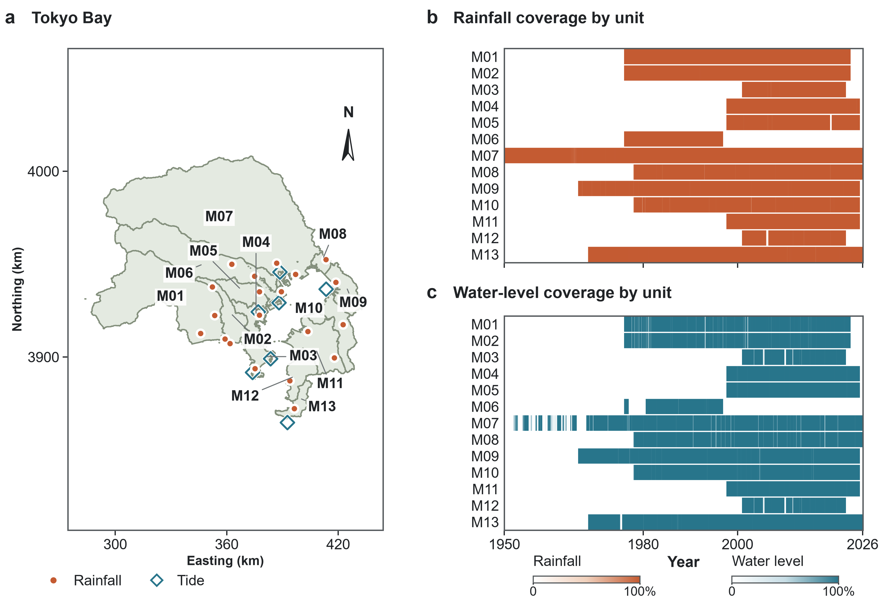</a>
</p>

Coverage refers to the archived compound-input record. Colour intensity represents the observed fraction of a calendar month; white indicates missing observations. Rainfall rows show actual source use. Annual-frequency analysis uses independently screened full records.

Panels b and c show rainfall and water-level coverage, respectively. Combined map labels identify polygons shared by two analysis units. Map coordinates use EPSG:6691, shown in kilometres.

## Analysis units

| Unit | Component subcatchments | Tide record |
|:--|:--|:--|
| M01 | TB01, TB02 | Aburatsubo |
| M02 | TB03, TB04 | Aburatsubo |
| M03 | TB05 | Kurihama |
| M04 | TB06, TB07 | Yokohama Shinko |
| M05 | TB08 | Yokohama Shinko |
| M06 | TB09, TB10 | Kawasaki |
| M07 | TB11, TB12, TB13 | Tokyo Harumi |
| M08 | TB14 | Tokyo Harumi |
| M09 | TB15, TB16 | Chiba |
| M10 | TB17, TB18 | Chiba |
| M11 | TB19, TB20, TB21 | Yokohama Shinko |
| M12 | TB22, TB23 | Kurihama |
| M13 | TB24 | Mera |

<details markdown="1">
<summary>Partitioning principles</summary>

The 24 source subcatchments, TB01–TB24, follow river systems and coastal outlets to Tokyo Bay and Sagami Bay. DEM drainage paths are constrained by W05 river lines and W07 basin boundaries, including low-relief watershed divides. Small coastal drainage areas are grouped by drainage destination and adjacency.

During source-subcatchment delineation, drainage pieces below 2 km² are joined to a neighbouring area, and units below 50 km² are preferentially grouped with adjacent small units. Detached pieces below 20 km² are assigned to an adjoining unit. These rules establish the 24 source subcatchments before their aggregation into the final analysis groups.

The final 13 units group these subcatchments by coastal drainage sector. Member outlets are related to the marine boundary segments, and the assigned tide records must support the required datum conversion and observation coverage. Units can share a tide record while retaining their own rainfall-source sequences and compound-event samples.

See [Methods](../shared/methods.md#analysis-units) for the common partitioning principles.

</details>

<details markdown="1">
<summary>Station assignment diagram</summary>

[View the station assignment diagram](figures/02_station_assignments.svg).

</details>

## Station catalogue

[M01](#unit-m01) · [M02](#unit-m02) · [M03](#unit-m03) · [M04](#unit-m04) · [M05](#unit-m05) · [M06](#unit-m06) · [M07](#unit-m07) · [M08](#unit-m08) · [M09](#unit-m09) · [M10](#unit-m10) · [M11](#unit-m11) · [M12](#unit-m12) · [M13](#unit-m13)

First and last use refer to actual station contributions. Panel a maps the stations; panel b shows monthly rainfall-source, water-level and paired observation coverage. Map numbers follow the rainfall table rows. Colour intensity represents the observed fraction of each month; white indicates no observations.

<details markdown="1">
<summary><strong>Unit M01</strong> · Aburatsubo · 2 rainfall stations</summary>

### Unit M01

Tide station: Aburatsubo · ID: `GESLA_JODC-GIAJ_GS01`.

| Priority | Rainfall station | ID | First use | Last use |
|--:|:--|:--|:--|:--|
| 1 | Hiratsuka | `JMA_A46136` | 1975-12-31 | 2023-12-31 |
| 2 | Ebina | `JMA_A46091` | 1976-10-23 | 2022-07-02 |

<p align="left">
  <a href="figures/M01_overview.svg">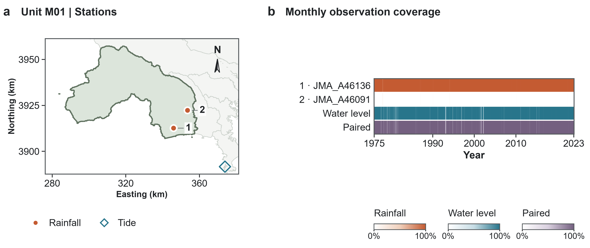</a>
</p>

</details>

<details markdown="1">
<summary><strong>Unit M02</strong> · Aburatsubo · 3 rainfall stations</summary>

### Unit M02

Tide station: Aburatsubo · ID: `GESLA_JODC-GIAJ_GS01`.

| Priority | Rainfall station | ID | First use | Last use |
|--:|:--|:--|:--|:--|
| 1 | Enoshima | `JMA_A46x0391` | 1975-12-31 | 1992-02-08 |
| 2 | Tsujido | `JMA_A46141` | 1992-02-10 | 2023-12-31 |
| 3 | Sagamihara-Chuo | `JMA_A46046` | 1977-04-18 | 2022-12-08 |

<p align="left">
  <a href="figures/M02_overview.svg">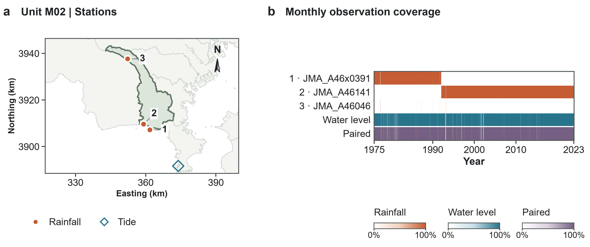</a>
</p>

</details>

<details markdown="1">
<summary><strong>Unit M03</strong> · Kurihama · 1 rainfall station</summary>

### Unit M03

Tide station: Kurihama · ID: `GESLA_JODC-PAHB_0161`.

| Priority | Rainfall station | ID | First use | Last use |
|--:|:--|:--|:--|:--|
| 1 | Miura | `JMA_A46211` | 2000-12-31 | 2022-12-31 |

<p align="left">
  <a href="figures/M03_overview.svg">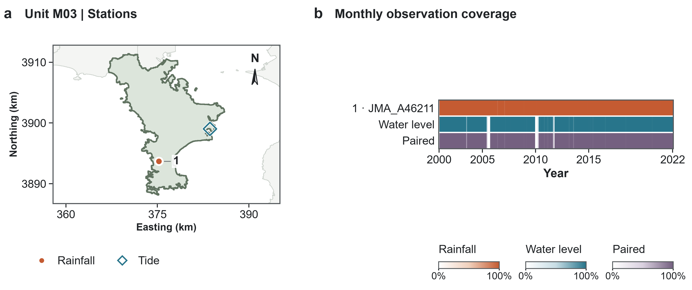</a>
</p>

</details>

<details markdown="1">
<summary><strong>Unit M04</strong> · Yokohama Shinko · 1 rainfall station</summary>

### Unit M04

Tide station: Yokohama Shinko · ID: `GESLA_JODC-JCG_HD29`.

| Priority | Rainfall station | ID | First use | Last use |
|--:|:--|:--|:--|:--|
| 1 | Yokohama | `JMA_47670` | 1997-08-31 | 2025-12-31 |

<p align="left">
  <a href="figures/M04_overview.svg">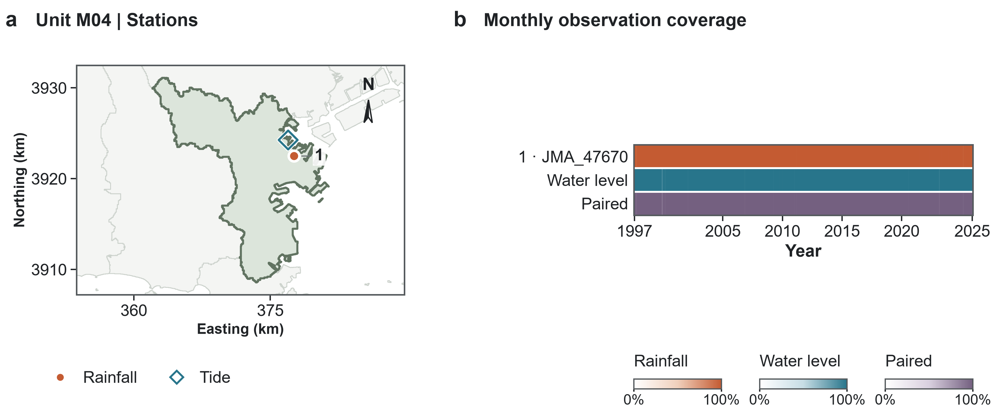</a>
</p>

</details>

<details markdown="1">
<summary><strong>Unit M05</strong> · Yokohama Shinko · 1 rainfall station</summary>

### Unit M05

Tide station: Yokohama Shinko · ID: `GESLA_JODC-JCG_HD29`.

| Priority | Rainfall station | ID | First use | Last use |
|--:|:--|:--|:--|:--|
| 1 | Hiyoshi | `JMA_A46061` | 1997-08-31 | 2025-12-31 |

<p align="left">
  <a href="figures/M05_overview.svg">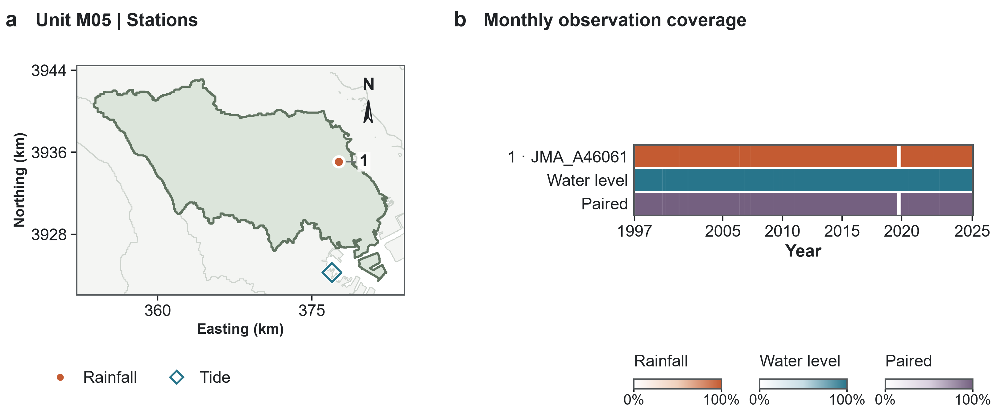</a>
</p>

</details>

<details markdown="1">
<summary><strong>Unit M06</strong> · Kawasaki · 3 rainfall stations</summary>

### Unit M06

Tide station: Kawasaki · ID: `JODC_MA59`.

| Priority | Rainfall station | ID | First use | Last use |
|--:|:--|:--|:--|:--|
| 1 | Haneda | `JMA_A44166` | 1975-12-31 | 1996-12-31 |
| 2 | Setagaya | `JMA_A44126` | 1987-05-22 | 1993-11-16 |
| 3 | Fuchu | `JMA_A44116` | 1978-02-18 | 1978-02-18 |

<p align="left">
  <a href="figures/M06_overview.svg">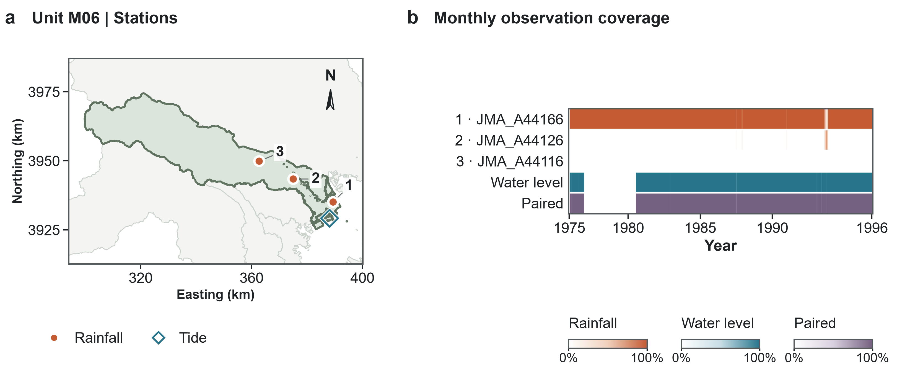</a>
</p>

</details>

<details markdown="1">
<summary><strong>Unit M07</strong> · Tokyo Harumi · 2 rainfall stations</summary>

### Unit M07

Tide station: Tokyo Harumi · ID: `JMA_TK`.

| Priority | Rainfall station | ID | First use | Last use |
|--:|:--|:--|:--|:--|
| 1 | Tokyo | `JMA_47662` | 1950-08-03 | 2026-07-31 |
| 3 | Edogawa-Rinkai | `JMA_A44136` | 1994-09-17 | 1998-01-08 |

<p align="left">
  <a href="figures/M07_overview.svg">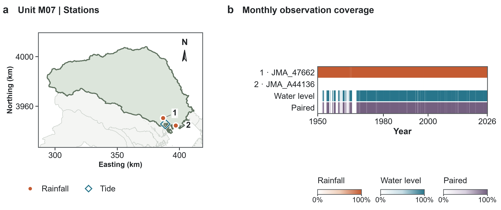</a>
</p>

</details>

<details markdown="1">
<summary><strong>Unit M08</strong> · Tokyo Harumi · 1 rainfall station</summary>

### Unit M08

Tide station: Tokyo Harumi · ID: `JMA_TK`.

| Priority | Rainfall station | ID | First use | Last use |
|--:|:--|:--|:--|:--|
| 1 | Funabashi | `JMA_A45106` | 1978-01-09 | 2026-07-31 |

<p align="left">
  <a href="figures/M08_overview.svg">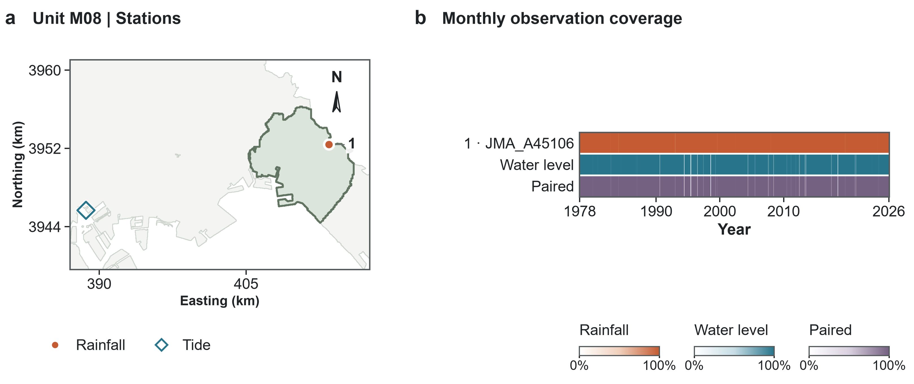</a>
</p>

</details>

<details markdown="1">
<summary><strong>Unit M09</strong> · Chiba · 1 rainfall station</summary>

### Unit M09

Tide station: Chiba · ID: `JODC_HD06`.

| Priority | Rainfall station | ID | First use | Last use |
|--:|:--|:--|:--|:--|
| 1 | Chiba | `JMA_47682` | 1966-03-31 | 2025-12-31 |

<p align="left">
  <a href="figures/M09_overview.svg">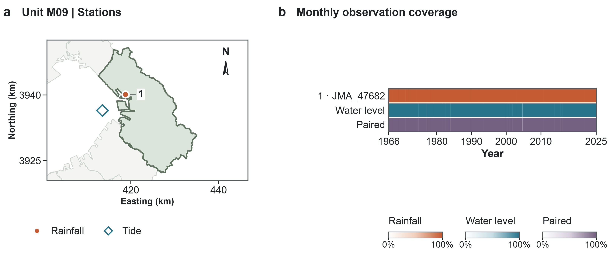</a>
</p>

</details>

<details markdown="1">
<summary><strong>Unit M10</strong> · Chiba · 1 rainfall station</summary>

### Unit M10

Tide station: Chiba · ID: `JODC_HD06`.

| Priority | Rainfall station | ID | First use | Last use |
|--:|:--|:--|:--|:--|
| 1 | Ushiku | `JMA_A45291` | 1978-01-11 | 2025-12-31 |

<p align="left">
  <a href="figures/M10_overview.svg">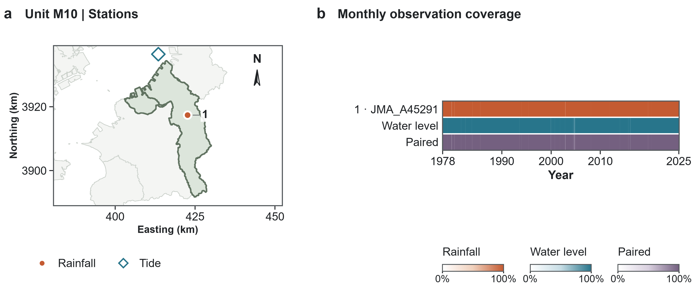</a>
</p>

</details>

<details markdown="1">
<summary><strong>Unit M11</strong> · Yokohama Shinko · 2 rainfall stations</summary>

### Unit M11

Tide station: Yokohama Shinko · ID: `GESLA_JODC-JCG_HD29`.

| Priority | Rainfall station | ID | First use | Last use |
|--:|:--|:--|:--|:--|
| 1 | Kisarazu | `JMA_A45282` | 1997-08-31 | 2025-12-31 |
| 2 | Sakahata | `JMA_A45326` | 2000-10-17 | 2022-11-16 |

<p align="left">
  <a href="figures/M11_overview.svg">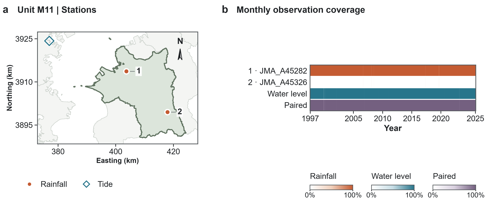</a>
</p>

</details>

<details markdown="1">
<summary><strong>Unit M12</strong> · Kurihama · 1 rainfall station</summary>

### Unit M12

Tide station: Kurihama · ID: `GESLA_JODC-PAHB_0161`.

| Priority | Rainfall station | ID | First use | Last use |
|--:|:--|:--|:--|:--|
| 1 | Kyonan | `JMA_A45346` | 2000-12-31 | 2022-12-31 |

<p align="left">
  <a href="figures/M12_overview.svg">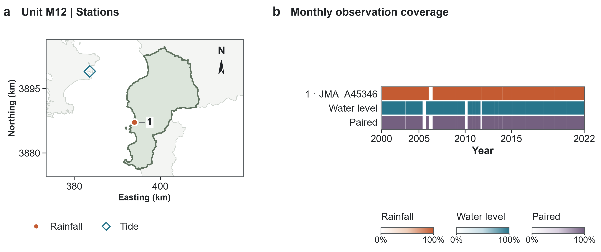</a>
</p>

</details>

<details markdown="1">
<summary><strong>Unit M13</strong> · Mera · 1 rainfall station</summary>

### Unit M13

Tide station: Mera · ID: `JMA_MR`.

| Priority | Rainfall station | ID | First use | Last use |
|--:|:--|:--|:--|:--|
| 1 | Tateyama | `JMA_47672` | 1968-05-10 | 2026-07-31 |

<p align="left">
  <a href="figures/M13_overview.svg">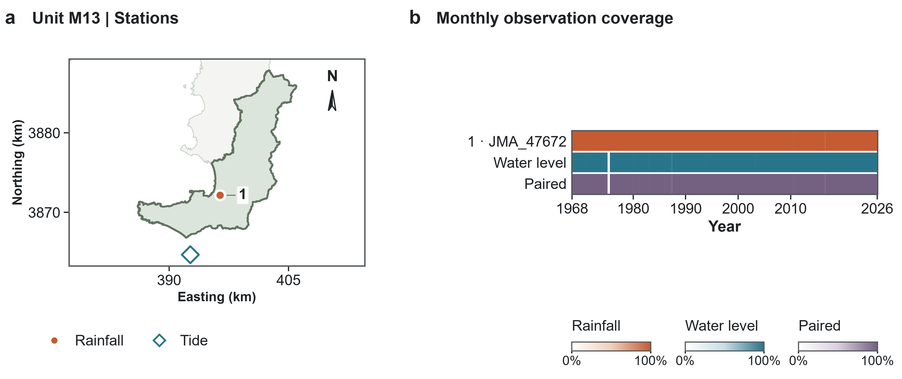</a>
</p>

</details>

## Regional settings

- JMA rainfall follows the declared station priority; valid zeros remain observed zeros, and missing values are not filled by interpolation.
- Tide conversion uses documented station epochs with JST boundaries. Unknown datum offsets are excluded. Source quality-code meanings remain provider-specific.
- Rainfall events use the shared hourly pairing, R95 threshold, and 72-hour declustering rules.
- S1 uses full-record moving-24-hour rainfall maxima. Overlapping annual-maximum windows at water-year boundaries are de-duplicated; reviewed annual observation samples can be supplied with their selection flags.
- S2 uses one full-record frequency curve per tide station. Kawasaki transfers the Tokyo-Harumi curve; Kurihama transfers the Aburatsubo curve, with concurrent annual-maximum median differences.
- Water-year 2026 remains in the accepted rainfall record.
- Regular rainfall and coastal peak times occur at hour 12.

## Run

From the repository root, install the package and run:

```sh
python -m pip install -e "."
python Tokyo/run_analysis.py --manifest ../private/tokyo/manifest.json --output ../outputs/tokyo
```

[run_analysis.py](run_analysis.py) executes steps 01–05: preparation, event selection, annual fitting, copula fitting and design export. [settings.py](settings.py) contains the regional parameters and station rules; [stations.json](stations.json) contains the station catalog. Use `--annual-only` for S1 and S2.

Read [Methods](../shared/methods.md) for the equations and [Inputs and sources](../shared/inputs.md) for observation formats. The study-area figures below are already in `figures/`.

Build the local documentation with `python build_docs.py --region tokyo` after installing `.[docs]`, then open `Tokyo/site/index.html`.
