# Greater Bay Area

Thirteen analysis units represent the Pearl River Estuary and Hong Kong coastal sectors. Coastal water level is analyzed in CN1985; model entry uses the source-system-specific conversion documented in the methods.

## Run

From the repository root, install the package and run:

```sh
python -m pip install -e "."
python gba/run_analysis.py --manifest ../private/gba/manifest.json --output ../outputs/gba
```

[run_analysis.py](run_analysis.py) executes steps 01–05: preparation, event selection, annual fitting, copula fitting and design export. [settings.py](settings.py) contains the regional parameters and station rules; [stations.json](stations.json) contains the station catalog. Use `--annual-only` for S1 and S2.

Read [Methods](../shared/methods.md) for the equations and [Inputs and sources](../shared/inputs.md) for observation formats. The study-area figures below are already in `figures/`.

Build the local documentation with `python build_docs.py --region gba` after installing `.[docs]`, then open `gba/site/index.html`.

## Tide assignments

| Units | Tide station |
|:--|:--|
| 01, 02 | SZ - Sanzao |
| 03a | DJZ - Dajiu Zhou |
| 03b | NLT - Nei Lingding |
| 04, 05 | NS - Nansha |
| 06 | DS - Dasheng |
| 07 | SSW - Sishengwei |
| 08 | CW - Chiwan |
| 09 | TBT - Tsim Bei Tsui |
| 10a | QUB - Quarry Bay |
| 10b | SPW - Shek Pik |
| 11 | TPK - Tai Po Kau |

## Regional settings

- Priority-merged daily rainfall is paired with daily highest coastal water level. Positive-day R95 and three-day declustering define the rainfall-triggered event sample.
- Mainland S1 units 01-08, including 03a/03b, use index-rainfall regional frequency analysis with long-record stations within 60 km. L-moment ratios are record-length weighted; H1 screening removes farthest stations if needed.
- Daily rainfall designs and compound rainfall coordinates use the empirical factor 1.13 to express estimated moving-24-hour quantities.
- S2 uses full station records with annual/seasonal completeness and regional storm-day checks. Independently sourced supplemental peaks remain private observation inputs.
- DJZ transfers the SZ curve; NLT transfers the CW curve, adding the median concurrent annual-maximum difference.
- Units 01, 02, and 05 exclude the documented invalid storm-day event pairs. Unit 10a uses a nondegenerate water-level margin and Gaussian dependence.
- Rainfall and tide peaks occur at hour 12 in regular event-design cases.


## Study area and station assignments

Select a figure to inspect it at full resolution.

[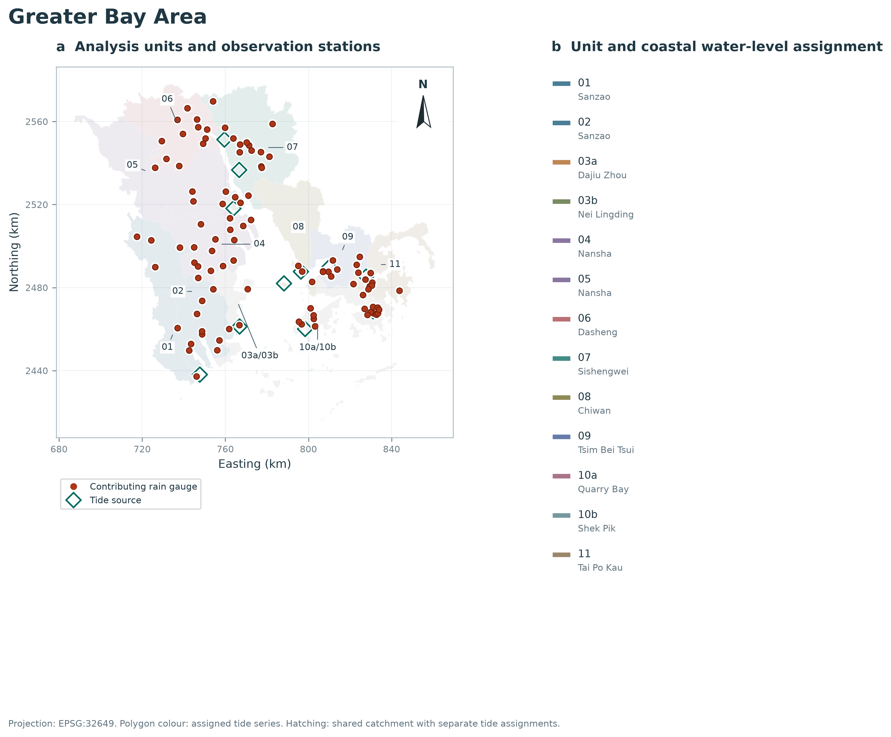](figures/01_study_area.png)

[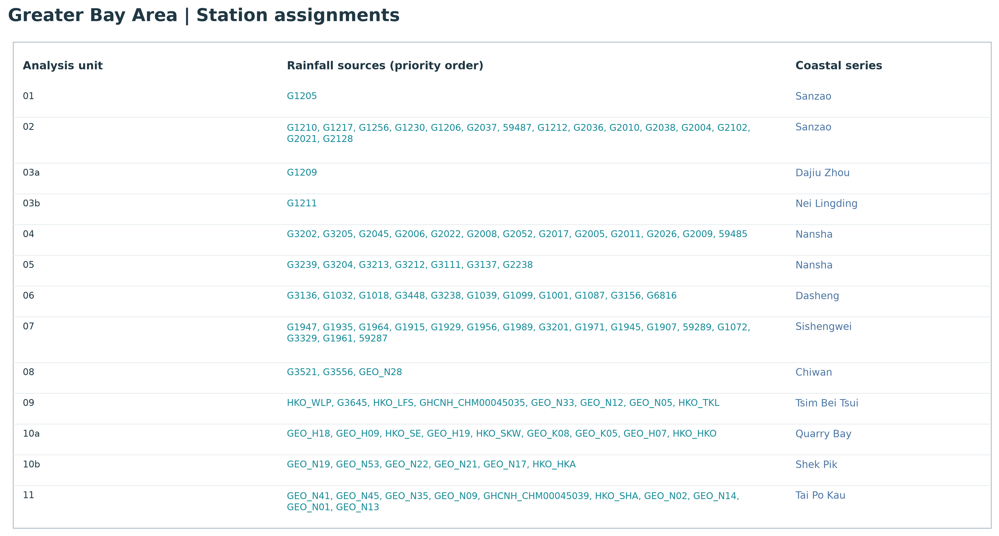](figures/02_station_assignments.png)

[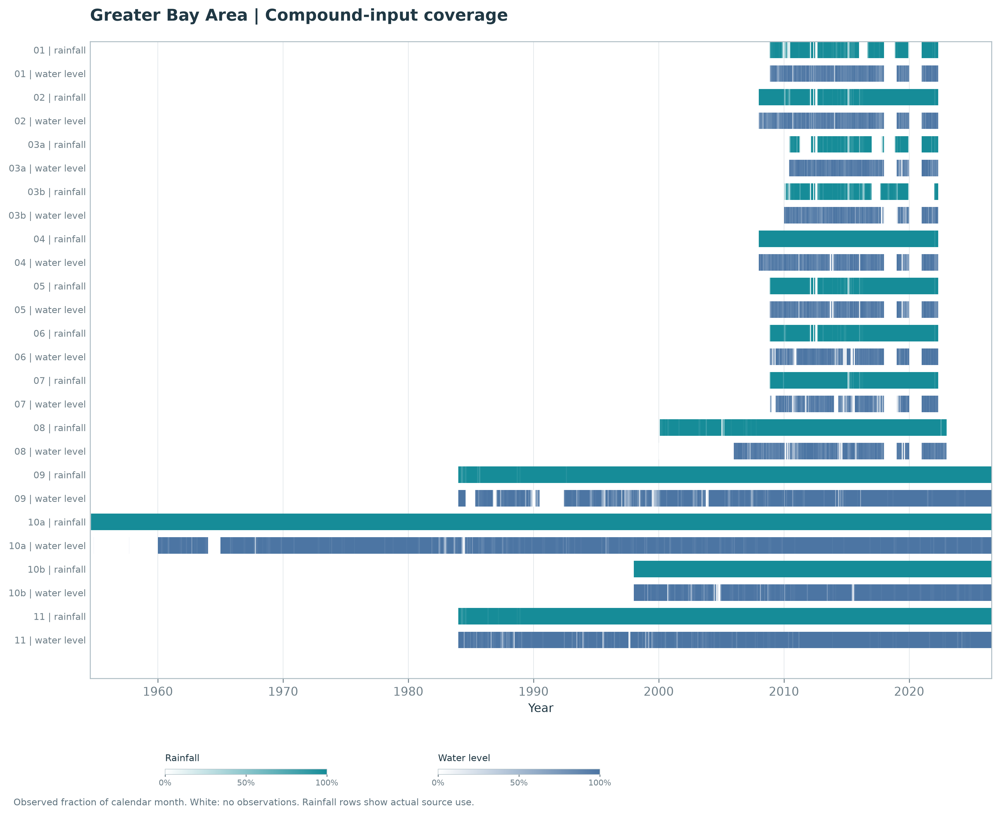](figures/03_observation_coverage.png)

Coverage refers to the archived compound-input record. Colour intensity represents the observed fraction of a calendar month; white indicates missing observations. Rainfall rows show actual source use. Annual-frequency analysis uses independently screened full records.

Units 03a/03b share a catchment polygon but use different coastal stations; 10a/10b have the same spatial relationship. Their event populations remain separate.

## Unit 01

Coastal series: Sanzao. Sources: `SZ`.

[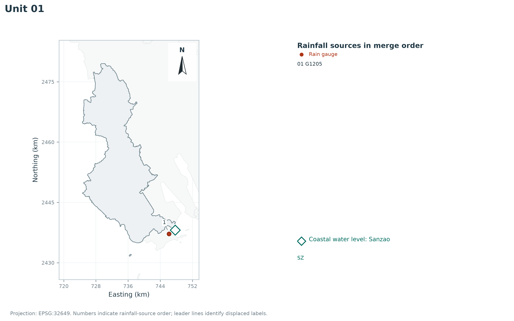](figures/01_stations.png)

| Priority | Rainfall station | ID | First use | Last use |
|--:|:--|:--|:--|:--|
| 1 | G1205 | `G1205` | 2008-11-20 | 2022-04-30 |

[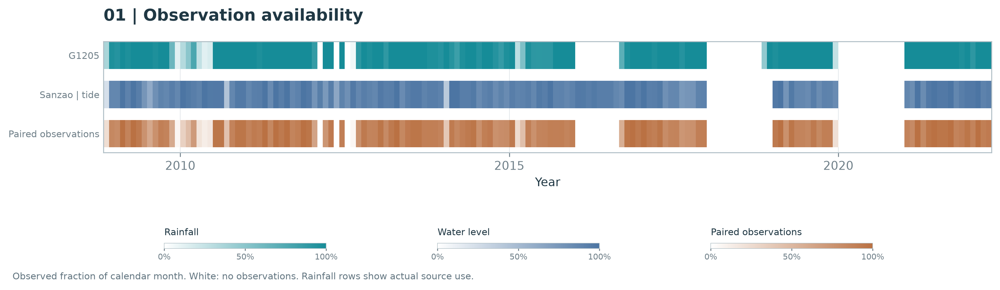](figures/01_coverage.png)

## Unit 02

Coastal series: Sanzao. Sources: `SZ`.

[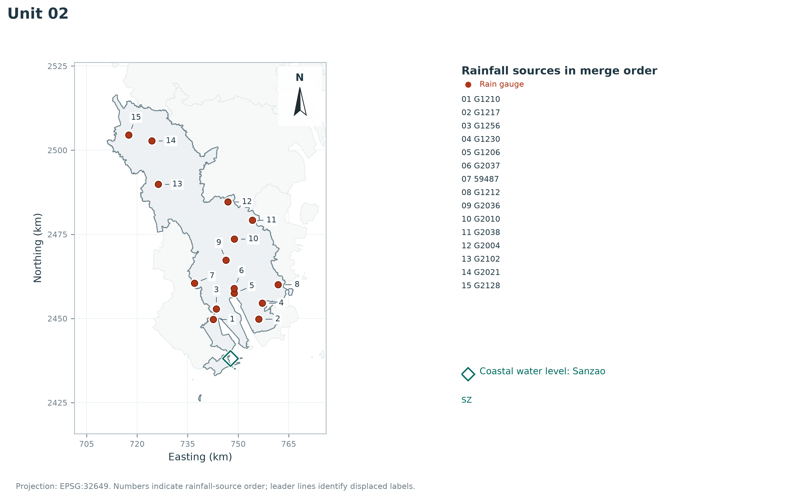](figures/02_stations.png)

| Priority | Rainfall station | ID | First use | Last use |
|--:|:--|:--|:--|:--|
| 1 | G1210 | `G1210` | 2009-04-01 | 2022-04-30 |
| 2 | G1217 | `G1217` | 2011-04-02 | 2021-12-31 |
| 3 | G1256 | `G1256` | 2019-12-09 | 2021-03-08 |
| 4 | G1230 | `G1230` | 2017-08-24 | 2020-12-28 |
| 5 | G1206 | `G1206` | 2008-11-20 | 2016-05-20 |
| 6 | G2037 | `G2037` | 2012-11-29 | 2018-02-06 |
| 7 | 59487 | `59487` | 2008-01-01 | 2014-12-25 |
| 8 | G1212 | `G1212` | 2010-02-05 | 2015-03-10 |
| 10 | G2036 | `G2036` | 2015-06-18 | 2017-03-14 |
| 12 | G2010 | `G2010` | 2010-04-13 | 2017-08-23 |
| 14 | G2038 | `G2038` | 2010-02-10 | 2010-02-10 |
| 17 | G2004 | `G2004` | 2010-05-05 | 2016-03-10 |
| 23 | G2102 | `G2102` | 2010-05-04 | 2010-05-04 |
| 27 | G2021 | `G2021` | 2010-06-19 | 2010-06-19 |
| 31 | G2128 | `G2128` | 2010-06-13 | 2010-06-29 |

[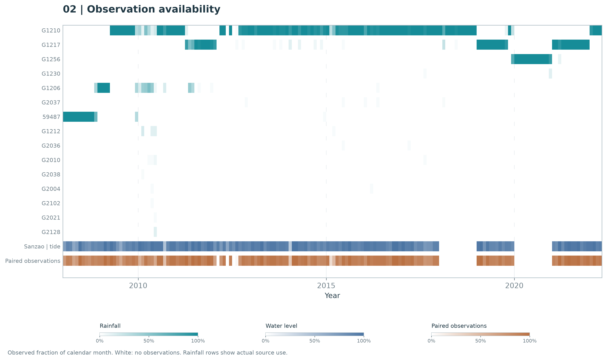](figures/02_coverage.png)

## Unit 03a

Coastal series: Dajiu Zhou. Sources: `DJZ`.

[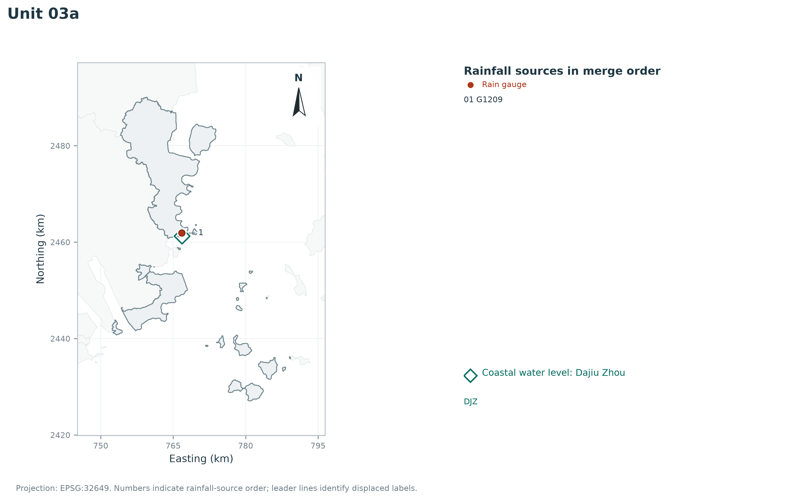](figures/03a_stations.png)

| Priority | Rainfall station | ID | First use | Last use |
|--:|:--|:--|:--|:--|
| 1 | G1209 | `G1209` | 2010-06-01 | 2022-04-30 |

[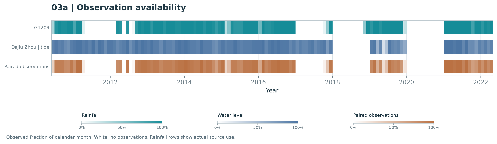](figures/03a_coverage.png)

## Unit 03b

Coastal series: Nei Lingding. Sources: `NLT`.

[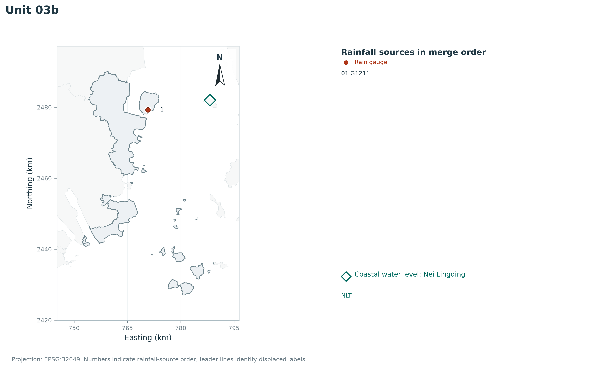](figures/03b_stations.png)

| Priority | Rainfall station | ID | First use | Last use |
|--:|:--|:--|:--|:--|
| 1 | G1211 | `G1211` | 2010-01-01 | 2022-04-30 |

[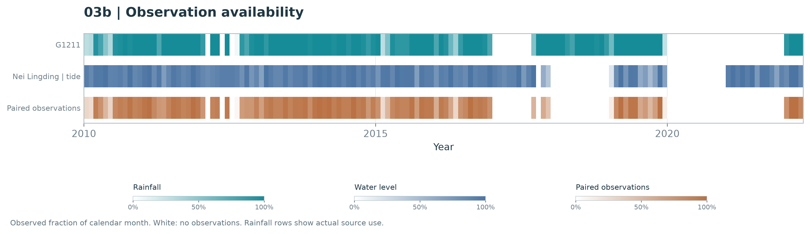](figures/03b_coverage.png)

## Unit 04

Coastal series: Nansha. Sources: `NS`.

[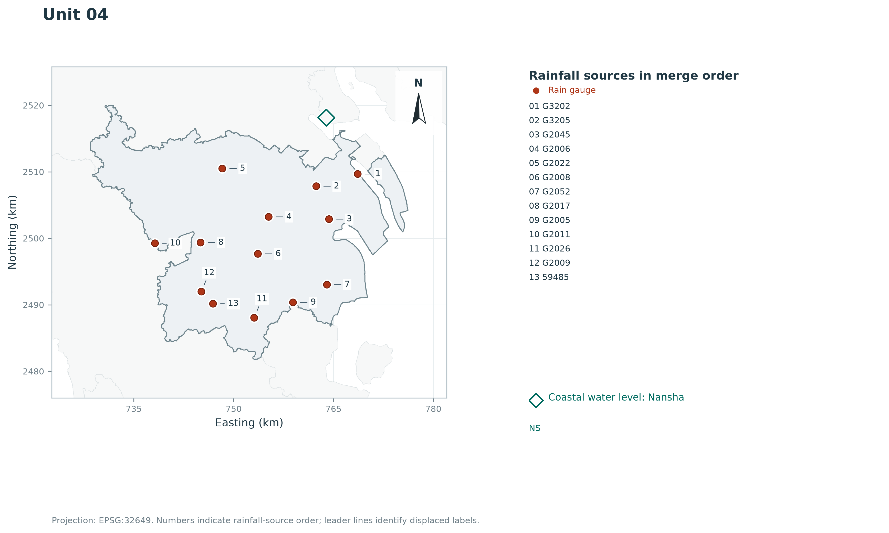](figures/04_stations.png)

| Priority | Rainfall station | ID | First use | Last use |
|--:|:--|:--|:--|:--|
| 1 | G3202 | `G3202` | 2009-04-01 | 2022-04-30 |
| 2 | G3205 | `G3205` | 2008-11-20 | 2018-12-10 |
| 4 | G2045 | `G2045` | 2009-12-03 | 2010-06-26 |
| 5 | G2006 | `G2006` | 2009-01-01 | 2010-03-29 |
| 6 | G2022 | `G2022` | 2009-11-24 | 2009-12-25 |
| 8 | G2008 | `G2008` | 2010-01-29 | 2010-01-29 |
| 10 | G2052 | `G2052` | 2013-10-19 | 2013-10-19 |
| 13 | G2017 | `G2017` | 2010-01-25 | 2015-03-10 |
| 14 | G2005 | `G2005` | 2010-02-12 | 2016-03-10 |
| 16 | G2011 | `G2011` | 2010-06-09 | 2010-06-09 |
| 17 | G2026 | `G2026` | 2010-02-08 | 2010-02-08 |
| 18 | G2009 | `G2009` | 2010-01-26 | 2010-01-26 |
| 19 | 59485 | `59485` | 2008-01-01 | 2016-04-01 |

[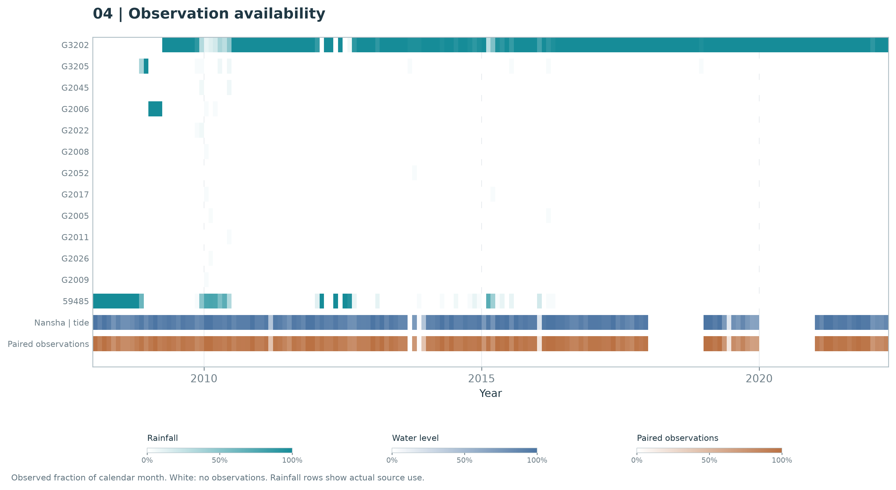](figures/04_coverage.png)

## Unit 05

Coastal series: Nansha. Sources: `NS`.

[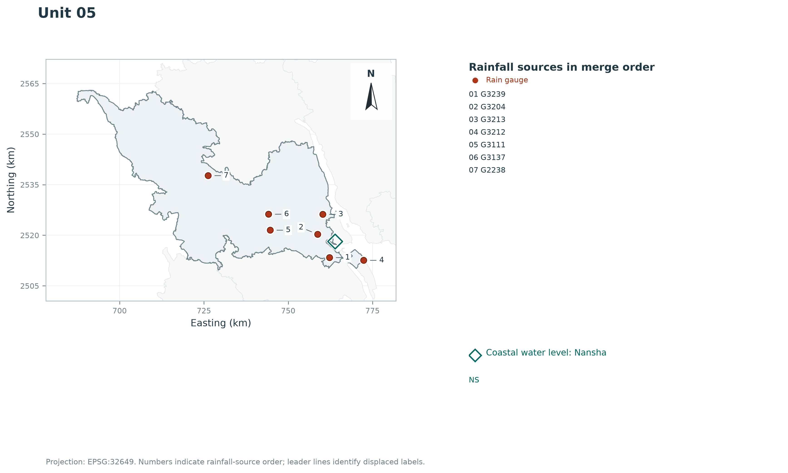](figures/05_stations.png)

| Priority | Rainfall station | ID | First use | Last use |
|--:|:--|:--|:--|:--|
| 1 | G3239 | `G3239` | 2009-04-01 | 2022-04-30 |
| 2 | G3204 | `G3204` | 2008-11-20 | 2020-12-31 |
| 3 | G3213 | `G3213` | 2009-01-01 | 2018-06-07 |
| 4 | G3212 | `G3212` | 2015-03-10 | 2019-01-27 |
| 11 | G3111 | `G3111` | 2009-12-05 | 2013-10-19 |
| 12 | G3137 | `G3137` | 2009-11-24 | 2010-04-03 |
| 25 | G2238 | `G2238` | 2016-03-10 | 2016-03-10 |

[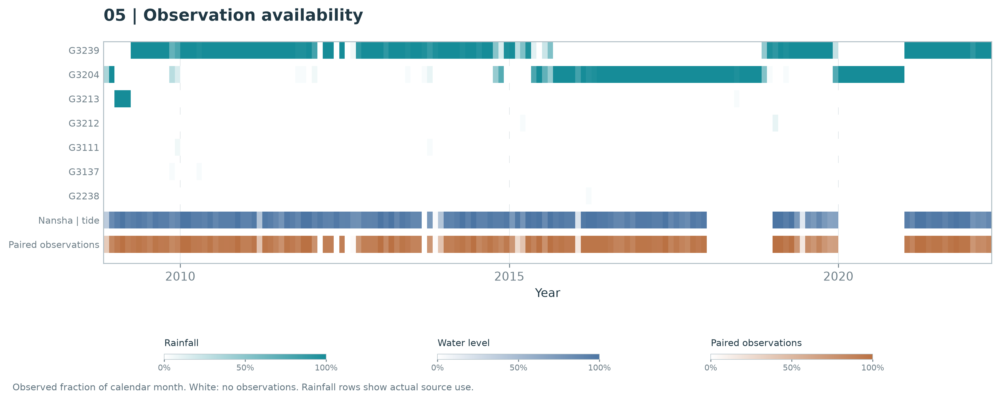](figures/05_coverage.png)

## Unit 06

Coastal series: Dasheng. Sources: `DS`.

[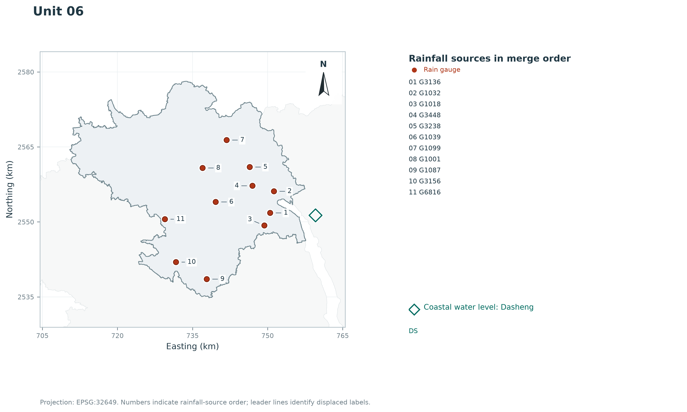](figures/06_stations.png)

| Priority | Rainfall station | ID | First use | Last use |
|--:|:--|:--|:--|:--|
| 1 | G3136 | `G3136` | 2008-11-20 | 2022-04-30 |
| 2 | G1032 | `G1032` | 2008-12-31 | 2011-04-13 |
| 3 | G1018 | `G1018` | 2009-12-07 | 2015-07-09 |
| 6 | G3448 | `G3448` | 2009-11-08 | 2010-06-30 |
| 9 | G3238 | `G3238` | 2015-03-10 | 2015-03-10 |
| 12 | G1039 | `G1039` | 2009-12-08 | 2010-05-23 |
| 15 | G1099 | `G1099` | 2009-12-16 | 2009-12-30 |
| 19 | G1001 | `G1001` | 2010-02-06 | 2010-02-06 |
| 21 | G1087 | `G1087` | 2015-02-09 | 2015-07-05 |
| 28 | G3156 | `G3156` | 2016-03-10 | 2016-03-10 |
| 29 | G6816 | `G6816` | 2009-12-28 | 2009-12-28 |

[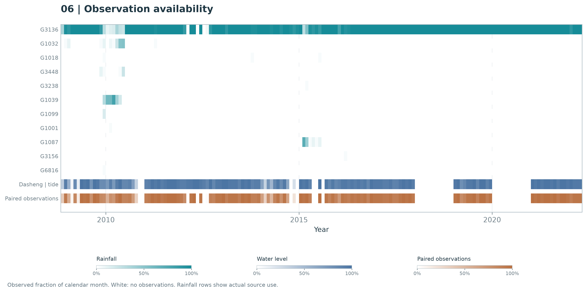](figures/06_coverage.png)

## Unit 07

Coastal series: Sishengwei. Sources: `SSW`.

[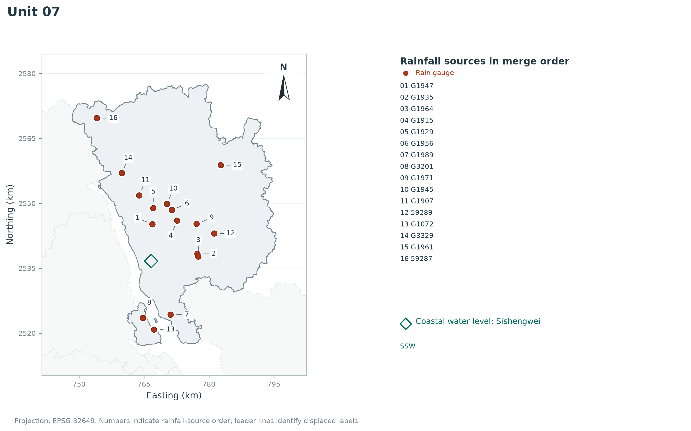](figures/07_stations.png)

| Priority | Rainfall station | ID | First use | Last use |
|--:|:--|:--|:--|:--|
| 1 | G1947 | `G1947` | 2008-11-20 | 2022-04-30 |
| 2 | G1935 | `G1935` | 2015-01-28 | 2021-03-16 |
| 3 | G1964 | `G1964` | 2009-11-12 | 2020-12-31 |
| 4 | G1915 | `G1915` | 2010-06-14 | 2010-09-07 |
| 5 | G1929 | `G1929` | 2010-01-22 | 2016-06-28 |
| 6 | G1956 | `G1956` | 2010-05-01 | 2016-06-05 |
| 7 | G1989 | `G1989` | 2009-12-09 | 2009-12-09 |
| 8 | G3201 | `G3201` | 2009-12-11 | 2010-06-27 |
| 9 | G1971 | `G1971` | 2015-03-10 | 2015-03-10 |
| 10 | G1945 | `G1945` | 2010-02-10 | 2010-02-26 |
| 12 | G1907 | `G1907` | 2010-01-17 | 2010-05-29 |
| 13 | 59289 | `59289` | 2010-01-01 | 2013-11-17 |
| 14 | G1072 | `G1072` | 2009-12-10 | 2009-12-30 |
| 23 | G3329 | `G3329` | 2009-11-18 | 2009-11-18 |
| 31 | G1961 | `G1961` | 2009-12-18 | 2009-12-18 |
| 40 | 59287 | `59287` | 2014-04-01 | 2014-12-25 |

[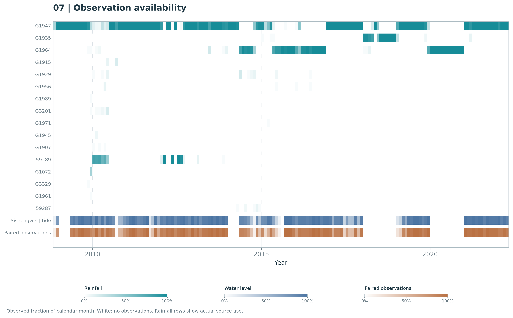](figures/07_coverage.png)

## Unit 08

Coastal series: Chiwan. Sources: `CW`.

[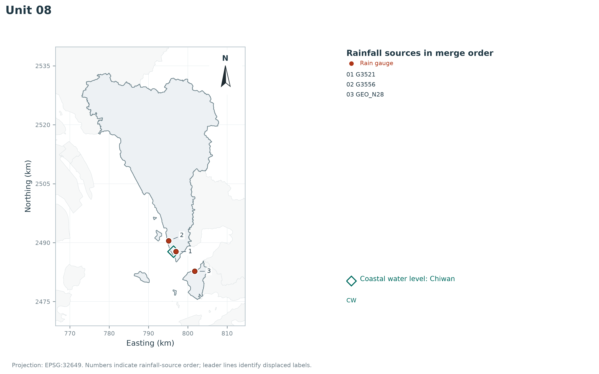](figures/08_stations.png)

| Priority | Rainfall station | ID | First use | Last use |
|--:|:--|:--|:--|:--|
| 1 | G3521 | `G3521` | 2008-11-20 | 2022-04-30 |
| 3 | G3556 | `G3556` | 2009-02-16 | 2010-06-30 |
| 7 | GEO_N28 | `GEO_N28` | 2000-01-28 | 2022-12-30 |

[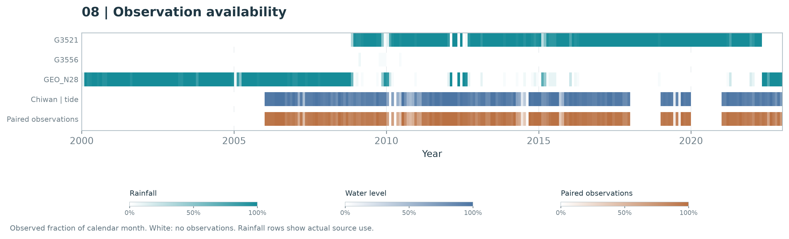](figures/08_coverage.png)

## Unit 09

Coastal series: Tsim Bei Tsui. Sources: `TBT`.

[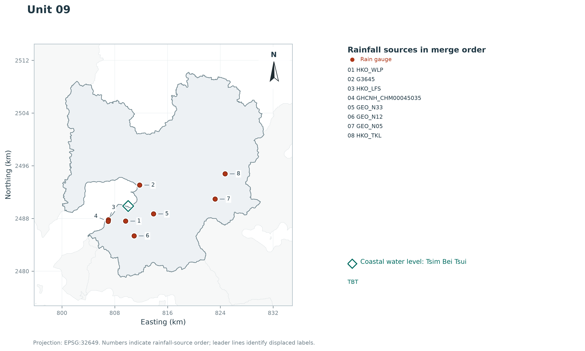](figures/09_stations.png)

| Priority | Rainfall station | ID | First use | Last use |
|--:|:--|:--|:--|:--|
| 1 | HKO_WLP | `HKO_WLP` | 2005-12-01 | 2026-07-31 |
| 2 | G3645 | `G3645` | 2017-05-23 | 2019-08-15 |
| 3 | HKO_LFS | `HKO_LFS` | 1985-10-01 | 2023-07-19 |
| 4 | GHCNH_CHM00045035 | `GHCNH_CHM00045035` | 2004-06-06 | 2014-07-07 |
| 5 | GEO_N33 | `GEO_N33` | 2000-01-21 | 2005-07-22 |
| 7 | GEO_N12 | `GEO_N12` | 1984-01-01 | 1999-05-31 |
| 49 | GEO_N05 | `GEO_N05` | 1989-01-12 | 1996-05-01 |
| 59 | HKO_TKL | `HKO_TKL` | 1988-07-27 | 1988-11-26 |

[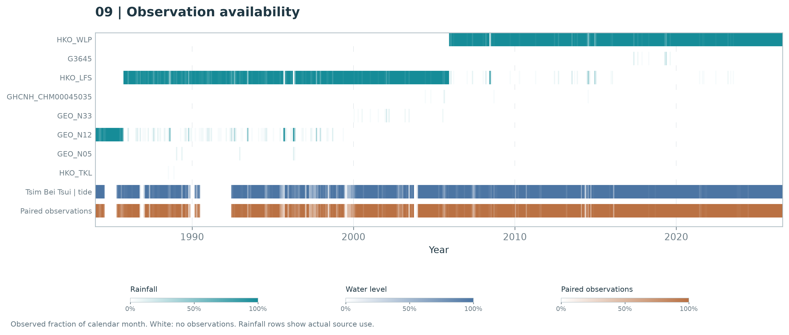](figures/09_coverage.png)

## Unit 10a

Coastal series: Quarry Bay. Sources: `QUB`.

[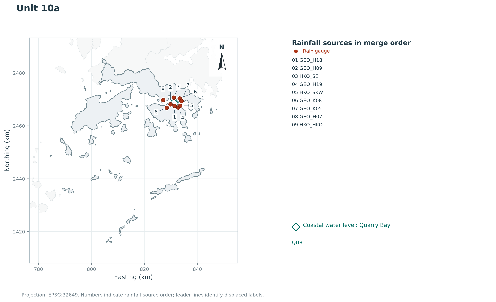](figures/10a_stations.png)

| Priority | Rainfall station | ID | First use | Last use |
|--:|:--|:--|:--|:--|
| 1 | GEO_H18 | `GEO_H18` | 1984-01-01 | 2026-06-30 |
| 2 | GEO_H09 | `GEO_H09` | 1987-07-03 | 2018-01-03 |
| 3 | HKO_SE | `HKO_SE` | 2011-12-25 | 2026-07-31 |
| 4 | GEO_H19 | `GEO_H19` | 1984-04-21 | 1996-06-18 |
| 5 | HKO_SKW | `HKO_SKW` | 2008-02-29 | 2008-02-29 |
| 6 | GEO_K08 | `GEO_K08` | 1986-12-04 | 2000-09-27 |
| 7 | GEO_K05 | `GEO_K05` | 1988-05-19 | 1989-01-11 |
| 8 | GEO_H07 | `GEO_H07` | 1988-02-13 | 1988-09-25 |
| 13 | HKO_HKO | `HKO_HKO` | 1954-08-29 | 2004-12-13 |

[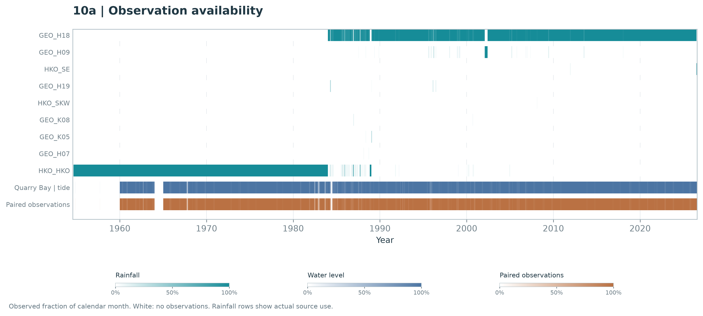](figures/10a_coverage.png)

## Unit 10b

Coastal series: Shek Pik. Sources: `SPW`.

[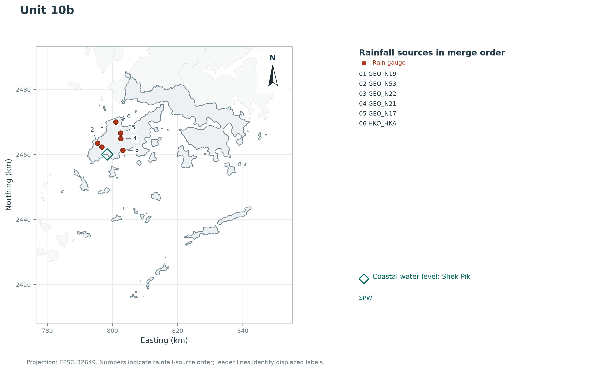](figures/10b_stations.png)

| Priority | Rainfall station | ID | First use | Last use |
|--:|:--|:--|:--|:--|
| 1 | GEO_N19 | `GEO_N19` | 1999-11-01 | 2026-06-30 |
| 2 | GEO_N53 | `GEO_N53` | 2012-03-12 | 2026-06-12 |
| 3 | GEO_N22 | `GEO_N22` | 1999-11-19 | 2015-01-14 |
| 4 | GEO_N21 | `GEO_N21` | 2001-09-01 | 2005-04-30 |
| 5 | GEO_N17 | `GEO_N17` | 1998-01-01 | 2005-10-18 |
| 7 | HKO_HKA | `HKO_HKA` | 1998-01-26 | 2026-07-31 |

[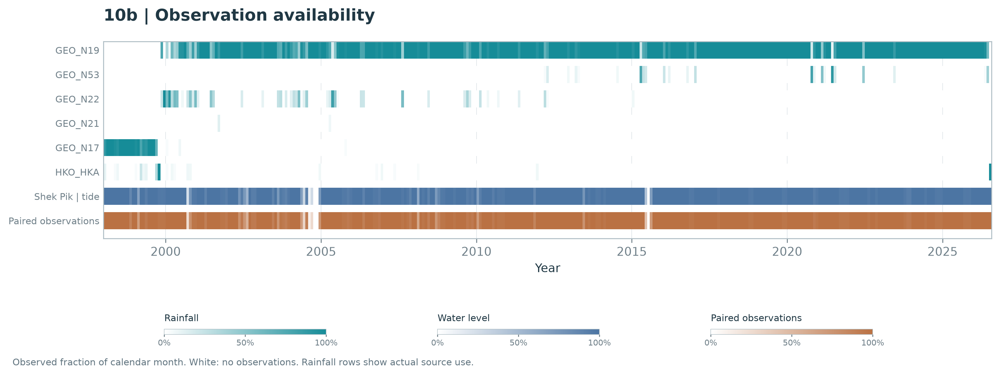](figures/10b_coverage.png)

## Unit 11

Coastal series: Tai Po Kau. Sources: `TPK`.

[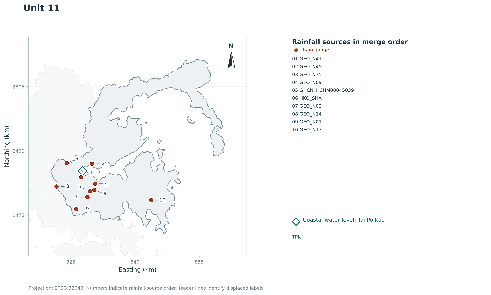](figures/11_stations.png)

| Priority | Rainfall station | ID | First use | Last use |
|--:|:--|:--|:--|:--|
| 1 | GEO_N41 | `GEO_N41` | 1999-11-01 | 2026-06-30 |
| 2 | GEO_N45 | `GEO_N45` | 2000-10-17 | 2025-06-24 |
| 3 | GEO_N35 | `GEO_N35` | 2005-10-18 | 2006-10-26 |
| 4 | GEO_N09 | `GEO_N09` | 1984-01-01 | 2000-01-16 |
| 5 | GHCNH_CHM00045039 | `GHCNH_CHM00045039` | 2004-12-11 | 2026-07-31 |
| 6 | HKO_SHA | `HKO_SHA` | 1985-03-26 | 2026-07-30 |
| 8 | GEO_N02 | `GEO_N02` | 1984-09-01 | 1996-06-18 |
| 10 | GEO_N14 | `GEO_N14` | 1984-04-05 | 1984-04-05 |
| 15 | GEO_N01 | `GEO_N01` | 1988-09-25 | 1988-09-25 |
| 30 | GEO_N13 | `GEO_N13` | 1984-05-16 | 1984-05-16 |

[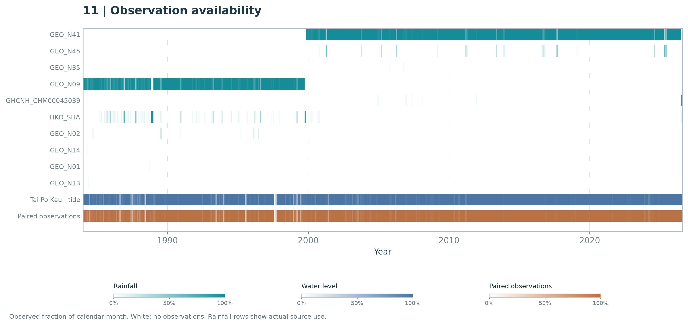](figures/11_coverage.png)
