# Tokyo Bay

Thirteen units represent the Tokyo Bay and Sagami Bay analysis sectors. Water levels enter inference in Tokyo Peil (T.P.). Event timing and October-to-September water years use Japan Standard Time.

## Run

From the repository root, install the package and run:

```sh
python -m pip install -e "."
python tokyo/run_analysis.py --manifest ../private/tokyo/manifest.json --output ../outputs/tokyo
```

[run_analysis.py](run_analysis.py) executes steps 01–05: preparation, event selection, annual fitting, copula fitting and design export. [settings.py](settings.py) contains the regional parameters and station rules; [stations.json](stations.json) contains the station catalog. Use `--annual-only` for S1 and S2.

Read [Methods](../shared/methods.md) for the equations and [Inputs and sources](../shared/inputs.md) for observation formats. The study-area figures below are already in `figures/`.

Build the local documentation with `python build_docs.py --region tokyo` after installing `.[docs]`, then open `tokyo/site/index.html`.

## Tide assignments

| Units | Tide station |
|:--|:--|
| M01, M02 | Aburatsubo |
| M03, M12 | Kurihama |
| M04, M05, M11 | Yokohama-Shinko |
| M06 | Kawasaki |
| M07, M08 | Tokyo-Harumi |
| M09, M10 | Chiba |
| M13 | Mera |

## Regional settings

- JMA rainfall follows the declared station priority; valid zeros remain observed zeros, and missing values are not filled by interpolation.
- Tide conversion uses documented station epochs with JST boundaries. Unknown datum offsets are excluded. Source quality-code meanings remain provider-specific.
- Rainfall events use the shared hourly pairing, R95 threshold, and 72-hour declustering rules.
- S1 uses full-record moving-24-hour rainfall maxima. Overlapping annual-maximum windows at water-year boundaries are de-duplicated; reviewed annual observation samples can be supplied with their selection flags.
- S2 uses one full-record frequency curve per tide station. Kawasaki transfers the Tokyo-Harumi curve; Kurihama transfers the Aburatsubo curve, with concurrent annual-maximum median differences.
- Water-year 2026 remains in the accepted rainfall record.
- Regular rainfall and coastal peak times occur at hour 12.


## Study area and station assignments

Select a figure to inspect it at full resolution.

[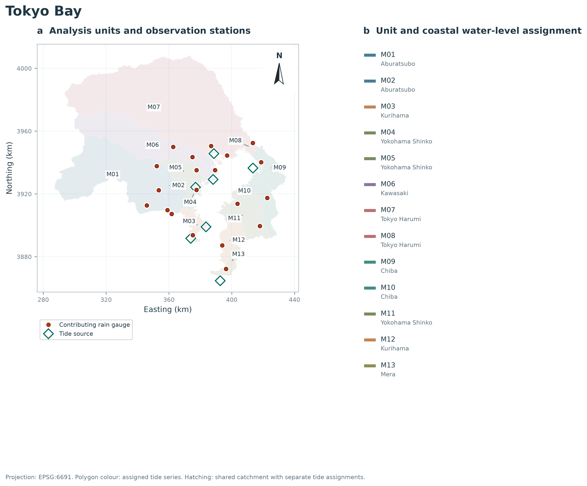](figures/01_study_area.png)

[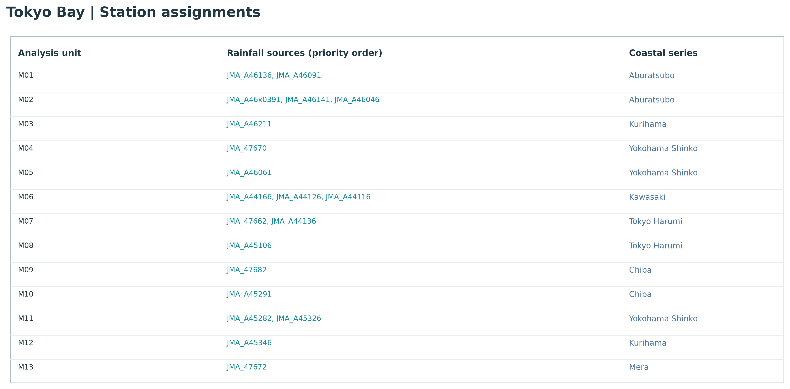](figures/02_station_assignments.png)

[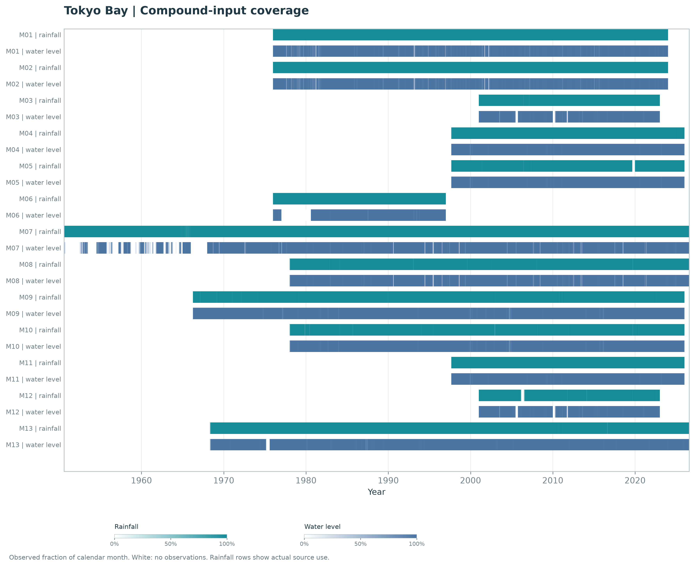](figures/03_observation_coverage.png)

Coverage refers to the archived compound-input record. Colour intensity represents the observed fraction of a calendar month; white indicates missing observations. Rainfall rows show actual source use. Annual-frequency analysis uses independently screened full records.

## Unit M01

Coastal series: Aburatsubo. Sources: `GESLA_JODC-GIAJ_GS01`.

[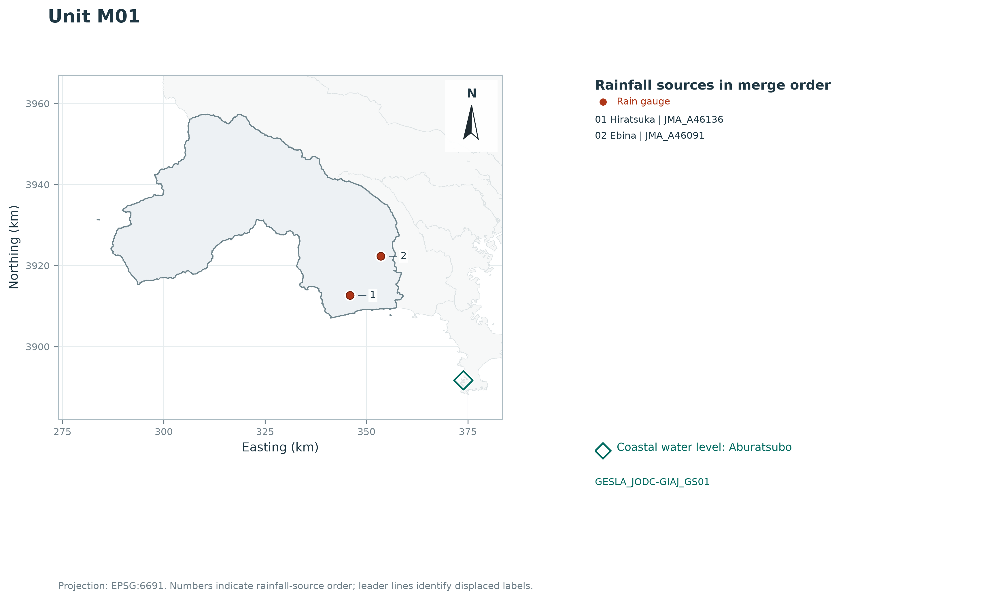](figures/M01_stations.png)

| Priority | Rainfall station | ID | First use | Last use |
|--:|:--|:--|:--|:--|
| 1 | Hiratsuka | `JMA_A46136` | 1975-12-31 | 2023-12-31 |
| 2 | Ebina | `JMA_A46091` | 1976-10-23 | 2022-07-02 |

[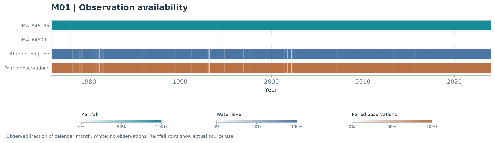](figures/M01_coverage.png)

## Unit M02

Coastal series: Aburatsubo. Sources: `GESLA_JODC-GIAJ_GS01`.

[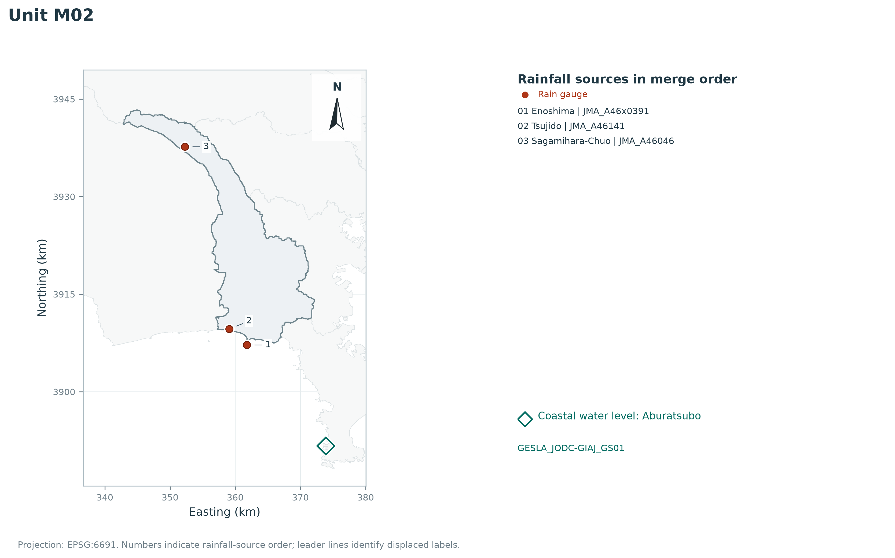](figures/M02_stations.png)

| Priority | Rainfall station | ID | First use | Last use |
|--:|:--|:--|:--|:--|
| 1 | Enoshima | `JMA_A46x0391` | 1975-12-31 | 1992-02-08 |
| 2 | Tsujido | `JMA_A46141` | 1992-02-10 | 2023-12-31 |
| 3 | Sagamihara-Chuo | `JMA_A46046` | 1977-04-18 | 2022-12-08 |

[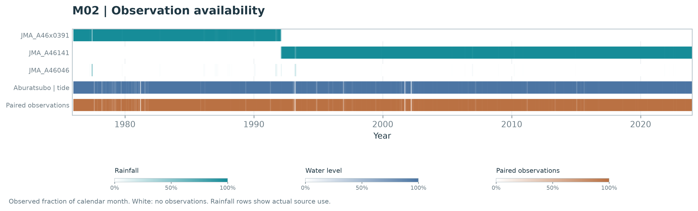](figures/M02_coverage.png)

## Unit M03

Coastal series: Kurihama. Sources: `GESLA_JODC-PAHB_0161`.

[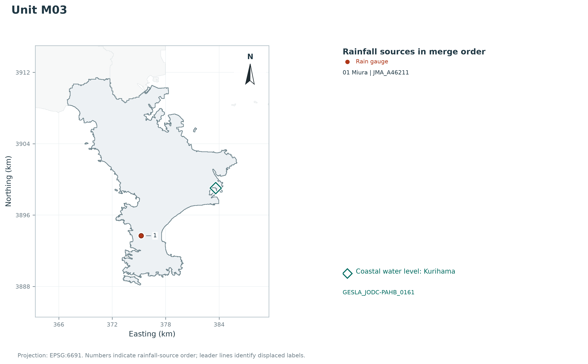](figures/M03_stations.png)

| Priority | Rainfall station | ID | First use | Last use |
|--:|:--|:--|:--|:--|
| 1 | Miura | `JMA_A46211` | 2000-12-31 | 2022-12-31 |

[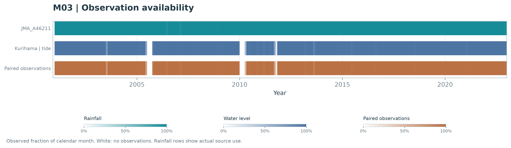](figures/M03_coverage.png)

## Unit M04

Coastal series: Yokohama Shinko. Sources: `GESLA_JODC-JCG_HD29`.

[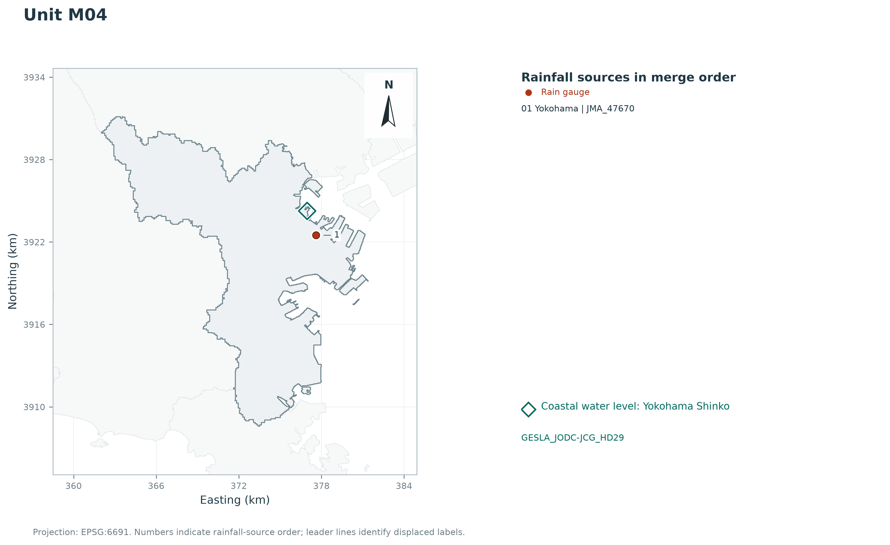](figures/M04_stations.png)

| Priority | Rainfall station | ID | First use | Last use |
|--:|:--|:--|:--|:--|
| 1 | Yokohama | `JMA_47670` | 1997-08-31 | 2025-12-31 |

[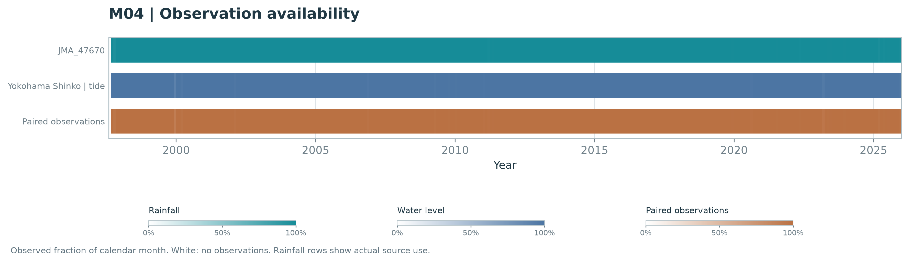](figures/M04_coverage.png)

## Unit M05

Coastal series: Yokohama Shinko. Sources: `GESLA_JODC-JCG_HD29`.

[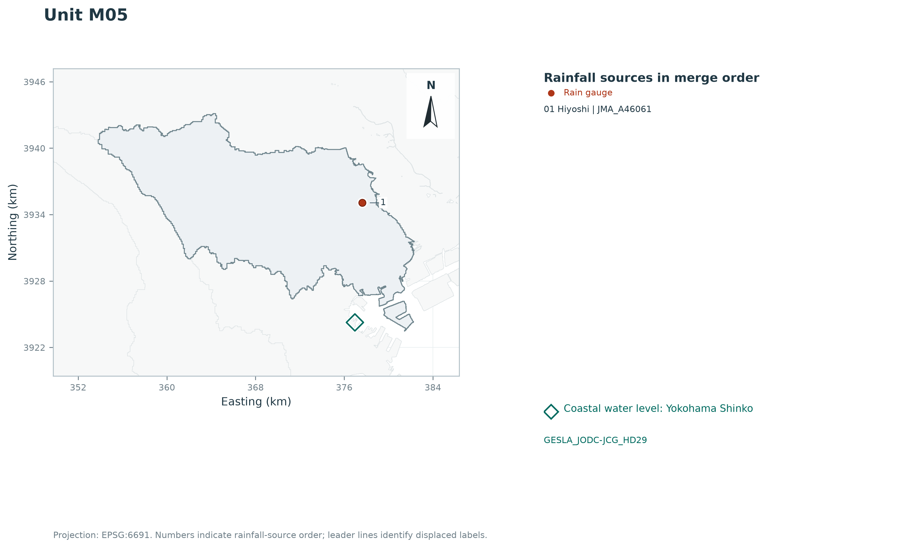](figures/M05_stations.png)

| Priority | Rainfall station | ID | First use | Last use |
|--:|:--|:--|:--|:--|
| 1 | Hiyoshi | `JMA_A46061` | 1997-08-31 | 2025-12-31 |

[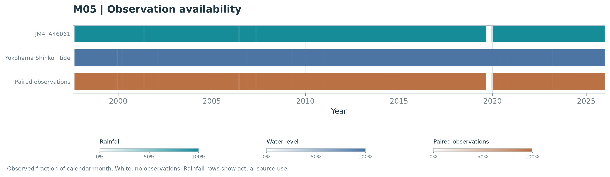](figures/M05_coverage.png)

## Unit M06

Coastal series: Kawasaki. Sources: `JODC_MA59`.

[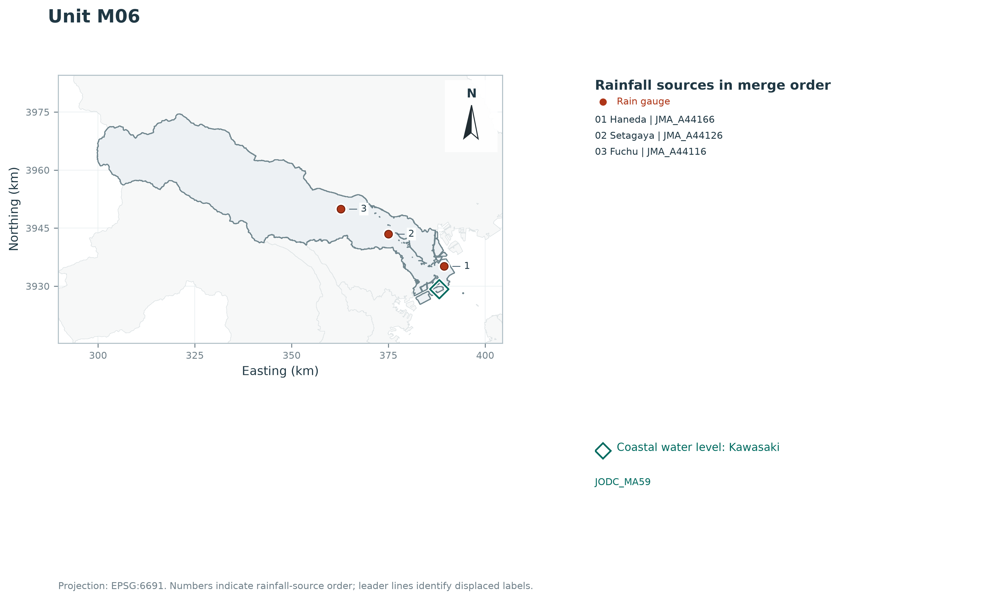](figures/M06_stations.png)

| Priority | Rainfall station | ID | First use | Last use |
|--:|:--|:--|:--|:--|
| 1 | Haneda | `JMA_A44166` | 1975-12-31 | 1996-12-31 |
| 2 | Setagaya | `JMA_A44126` | 1987-05-22 | 1993-11-16 |
| 3 | Fuchu | `JMA_A44116` | 1978-02-18 | 1978-02-18 |

[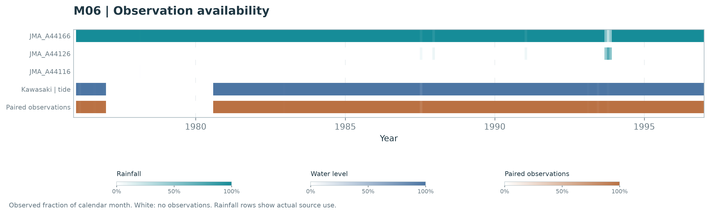](figures/M06_coverage.png)

## Unit M07

Coastal series: Tokyo Harumi. Sources: `JMA_TK`.

[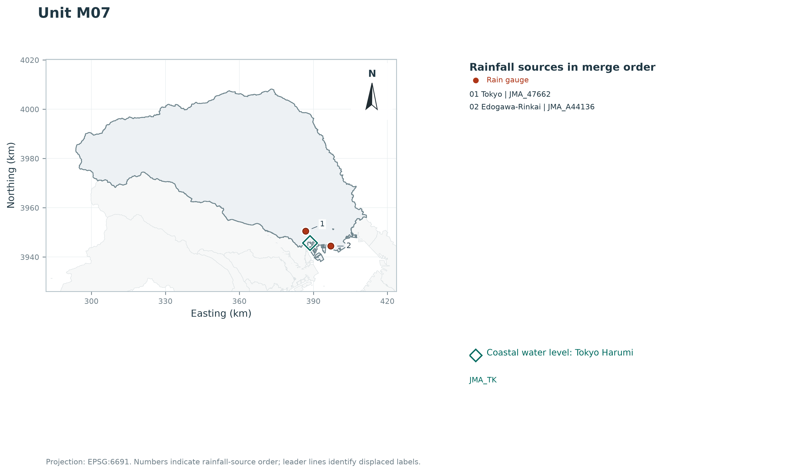](figures/M07_stations.png)

| Priority | Rainfall station | ID | First use | Last use |
|--:|:--|:--|:--|:--|
| 1 | Tokyo | `JMA_47662` | 1950-08-03 | 2026-07-31 |
| 3 | Edogawa-Rinkai | `JMA_A44136` | 1994-09-17 | 1998-01-08 |

[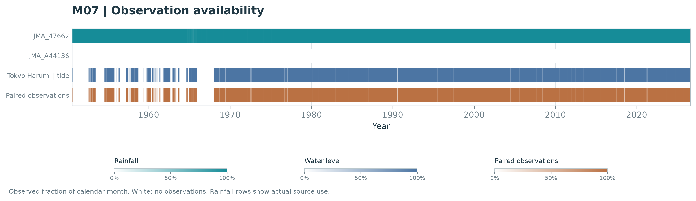](figures/M07_coverage.png)

## Unit M08

Coastal series: Tokyo Harumi. Sources: `JMA_TK`.

[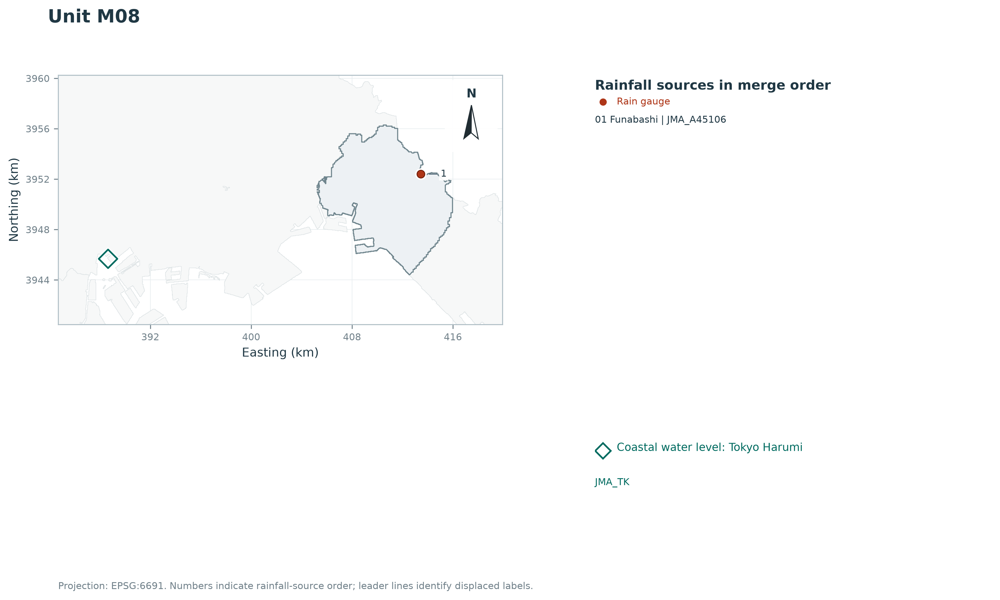](figures/M08_stations.png)

| Priority | Rainfall station | ID | First use | Last use |
|--:|:--|:--|:--|:--|
| 1 | Funabashi | `JMA_A45106` | 1978-01-09 | 2026-07-31 |

[](figures/M08_coverage.png)

## Unit M09

Coastal series: Chiba. Sources: `JODC_HD06`.

[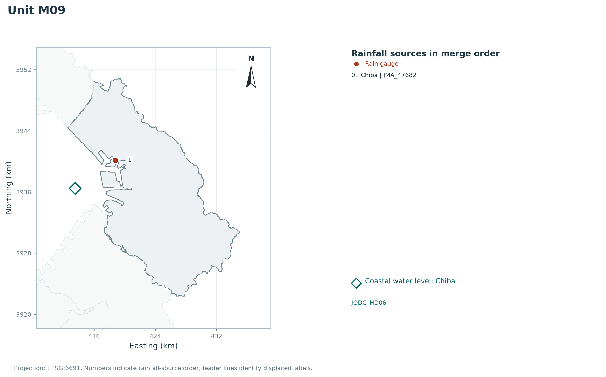](figures/M09_stations.png)

| Priority | Rainfall station | ID | First use | Last use |
|--:|:--|:--|:--|:--|
| 1 | Chiba | `JMA_47682` | 1966-03-31 | 2025-12-31 |

[](figures/M09_coverage.png)

## Unit M10

Coastal series: Chiba. Sources: `JODC_HD06`.

[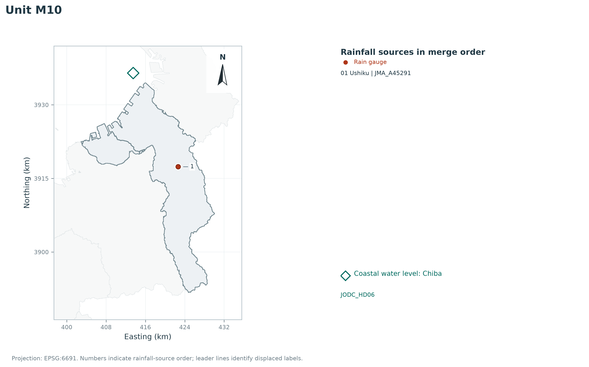](figures/M10_stations.png)

| Priority | Rainfall station | ID | First use | Last use |
|--:|:--|:--|:--|:--|
| 1 | Ushiku | `JMA_A45291` | 1978-01-11 | 2025-12-31 |

[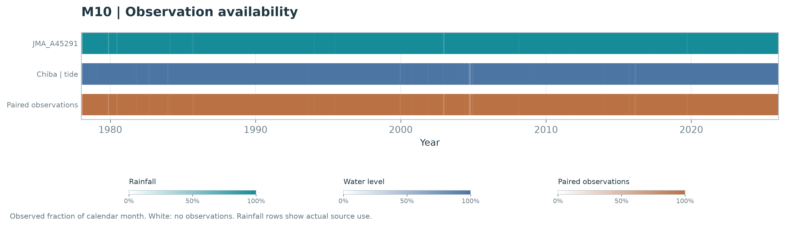](figures/M10_coverage.png)

## Unit M11

Coastal series: Yokohama Shinko. Sources: `GESLA_JODC-JCG_HD29`.

[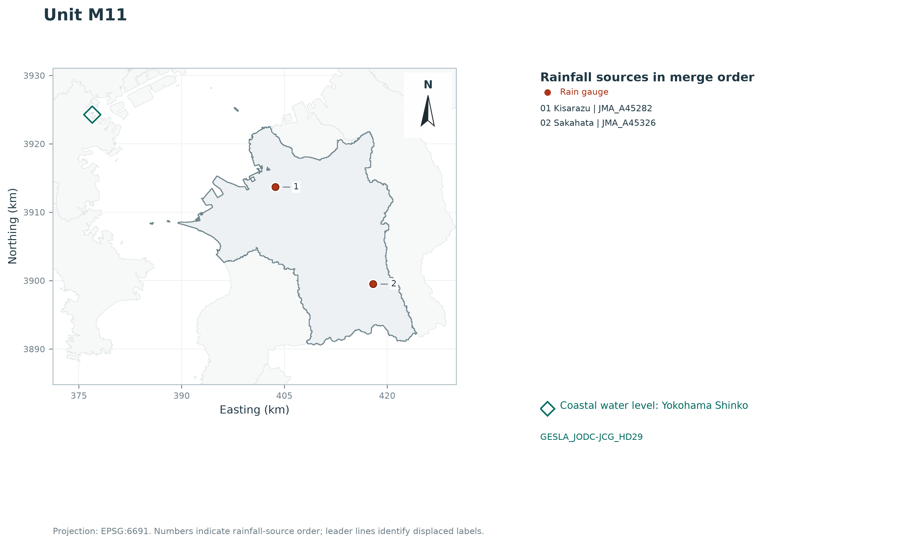](figures/M11_stations.png)

| Priority | Rainfall station | ID | First use | Last use |
|--:|:--|:--|:--|:--|
| 1 | Kisarazu | `JMA_A45282` | 1997-08-31 | 2025-12-31 |
| 2 | Sakahata | `JMA_A45326` | 2000-10-17 | 2022-11-16 |

[](figures/M11_coverage.png)

## Unit M12

Coastal series: Kurihama. Sources: `GESLA_JODC-PAHB_0161`.

[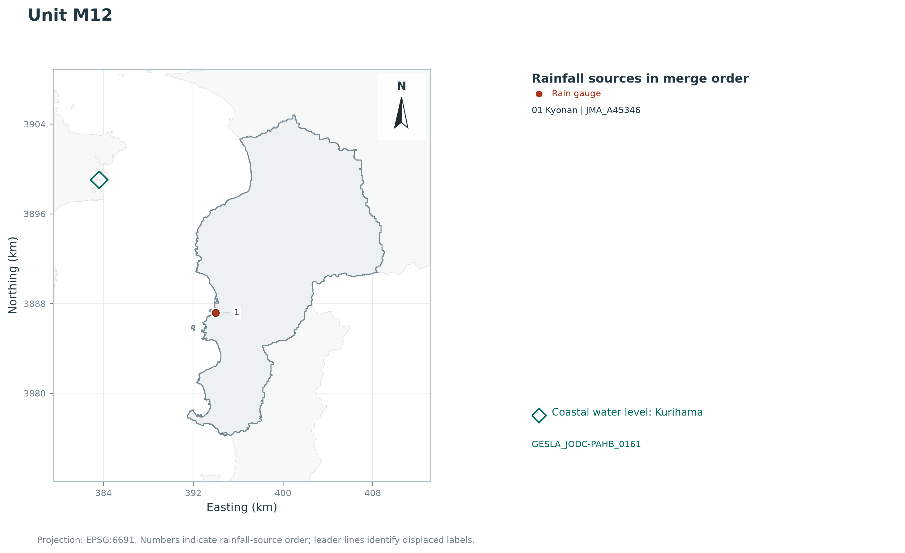](figures/M12_stations.png)

| Priority | Rainfall station | ID | First use | Last use |
|--:|:--|:--|:--|:--|
| 1 | Kyonan | `JMA_A45346` | 2000-12-31 | 2022-12-31 |

[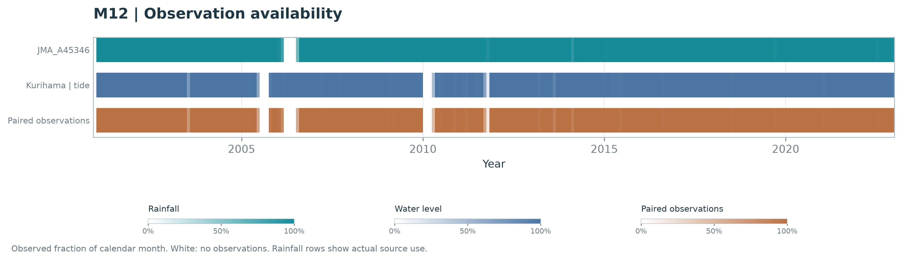](figures/M12_coverage.png)

## Unit M13

Coastal series: Mera. Sources: `JMA_MR`.

[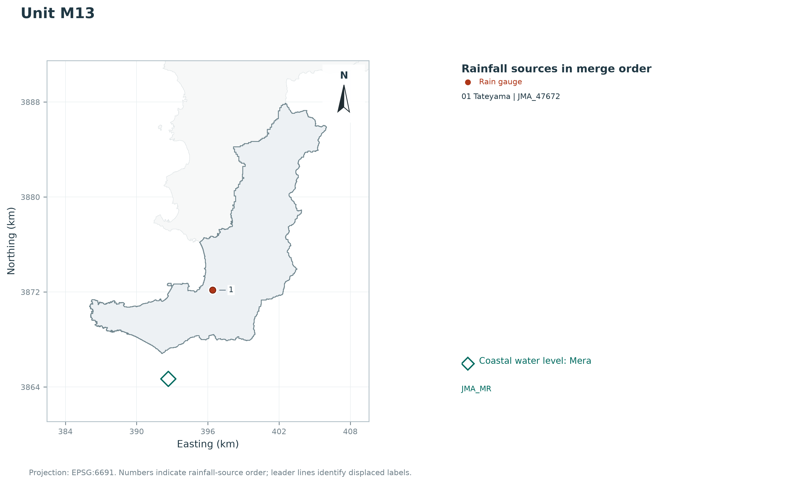](figures/M13_stations.png)

| Priority | Rainfall station | ID | First use | Last use |
|--:|:--|:--|:--|:--|
| 1 | Tateyama | `JMA_47672` | 1968-05-10 | 2026-07-31 |

[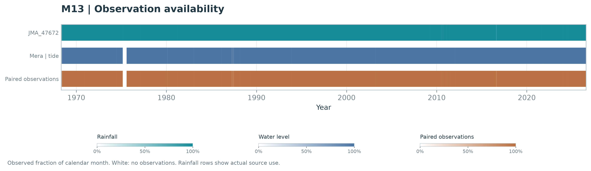](figures/M13_coverage.png)
